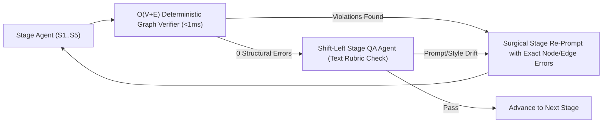
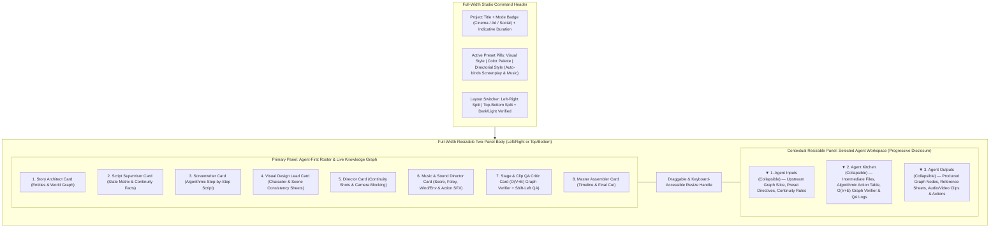

# Implementation Plan: Agent-First Production Studio, Style & Palette Presets, $O(V+E)$ Graph Verifier + Shift-Left QA & Honest Codebase Index

This plan addresses all 9 architectural and product requirements plus the 4 refinements while strictly enforcing the repository's coding standards (max 400 non-comment statements per file, max 30 statements per function, strict Python/TypeScript typing, zero raw HTML controls in `frontend/src/`, zero AST clones, and 4-tier isolation).

---

## 1. Honest Codebase Index Checker (`scripts/check_codebase_index.py` & `scripts/generate_codebase_index.py`)

### Goal
Ensure [`CODEBASE_INDEX.json`](file:///usr/local/google/home/sanjeetsahay/projects/veogen/CODEBASE_INDEX.json) and [`CODEBASE_INDEX.md`](file:///usr/local/google/home/sanjeetsahay/projects/veogen/CODEBASE_INDEX.md) never drift when files are added, moved, renamed, deleted, or when exported symbols/tiers change.

### Proposed Changes
- **[NEW] [`scripts/check_codebase_index.py`](file:///usr/local/google/home/sanjeetsahay/projects/veogen/scripts/check_codebase_index.py)**:
  - Computes the live repository index in-memory using [`build_index()`](file:///usr/local/google/home/sanjeetsahay/projects/veogen/scripts/generate_codebase_index.py#L148-L194) and [`render_markdown()`](file:///usr/local/google/home/sanjeetsahay/projects/veogen/scripts/generate_codebase_index.py#L197-L243) (ignoring the volatile `generated_at` timestamp).
  - Uses $O(N)$ hash-map set difference between live tracked files and indexed files to report exact drift categories:
    - **Added / Unindexed files** (present on disk in tracked roots, missing from index)
    - **Deleted / Moved phantom files** (present in `CODEBASE_INDEX.json`, missing on disk)
    - **Stale symbol / tier / statement count metadata**
  - Supports `--sync` (updates both files in place and logs semantic diff) and `--check` (exits non-zero if any drift is detected).
- **[MODIFY] [`scripts/pre-deploy.sh`](file:///usr/local/google/home/sanjeetsahay/projects/veogen/scripts/pre-deploy.sh)**:
  - Run `python3 scripts/check_codebase_index.py --sync` followed by `python3 scripts/check_codebase_index.py --check` so pre-deploy both refreshes and verifies index honesty.
- **[MODIFY] [`api/tests/test_architecture_and_duplication.py`](file:///usr/local/google/home/sanjeetsahay/projects/veogen/api/tests/test_architecture_and_duplication.py)**:
  - Add a unit test asserting `check_codebase_index.py --check` passes with zero unindexed or phantom files.

---

## 2. Production Frontend Format Modes, Indicative Duration & Zero Prompt Selection

### Goal
Properly differentiate **Cinematic Videos (`movie`)**, **Commercial Ads (`advertizement`)**, and **Social Videos (`social`)** in the Production creation UI, treat selected duration as **indicative pacing** (while story content decides actual length), and ensure no system prompt / schema selector is shown.

### Mode Specifications
| Format Mode | Aspect Ratio / Framing | Indicative Duration Options | Story Pacing Behavior |
| :--- | :--- | :--- | :--- |
| **Cinematic Videos (`movie`)** | Widescreen `16:9` (`horizontal` locked default) | `60s` (~1m), `120s` (~2m), `180s` (3m+ Long-Form) | Multi-scene narrative arc; content determines total scenes & runtime (can exceed 3 minutes). |
| **Commercial Ads (`advertizement`)** | `16:9` (Landscape) or `9:16` (Vertical) | `15s` (Bumper/Spot), `30s` (Standard Commercial) | High-impact hook, product/brand hero showcase, and crisp call-to-action up to ~30 seconds. |
| **Social Videos (`social`)** | `9:16` (Tall/Reels/Shorts default) or `16:9` (Wide) | `30s`, `60s` (~1m), `90s` (1m+ Deep Story) | Fast-paced retention hook; tall or wide; content drives exact length (1+ minutes supported). |

### Proposed Changes
- **[MODIFY] [`frontend/src/types/project.ts`](file:///usr/local/google/home/sanjeetsahay/projects/veogen/frontend/src/types/project.ts)**:
  - Expand `projectSchema` and `Project` with optional preset fields (`visual_style_preset`, `color_palette_preset`, `director_style_preset`) and `duration_mode: 'content_driven' | 'indicative'`.
- **[MODIFY] [`frontend/src/components/ads/ProjectForm.tsx`](file:///usr/local/google/home/sanjeetsahay/projects/veogen/frontend/src/components/ads/ProjectForm.tsx)** & **[`frontend/src/components/ads/projects/ProjectFormSections.tsx`](file:///usr/local/google/home/sanjeetsahay/projects/veogen/frontend/src/components/ads/projects/ProjectFormSections.tsx)**:
  - When switching `type` (`movie` | `advertizement` | `social`), automatically set sensible defaults for `orientation` (`16:9` for `movie`, `9:16` for `social`, `16:9` or `9:16` for `advertizement`) and indicative `video_length`.
  - Relabel the duration selector to **Indicative Pacing Target** with helper badge: *"Story content decides final runtime — duration guides scene pacing."*
  - Keep prompt/schema selection completely removed from the user flow.

---

## 3. Role Definitions, Visual Styles (incl. Lego, Clay, Pixelated), Color Palettes & Director-Driven Auto-Presets

### Goal
Clearly define the roles of **Screenplay Writer**, **Director**, and **Music Director**. In the Frontend UI, expose **3 clean creative selectors**:
1. **Visual Style Preset** (including **Lego**, **Clay / Stop-Motion**, and **Pixelated / Voxel** alongside Pixar-esque 3D, Ghibli, Niji, Chibi, Manga/Anime, Superhero Blockbuster, Indie Arthouse, 80s, 70s, Mythological Epic)
2. **Color Palette Preset** (Pastel, Monochromatic, Vibrant, Warm Golden, Noir Teal, Earthy Organic, Neon Synth, Vintage Film, Jewel-Toned)
3. **Directorial Style Preset** (named by cinematic archetype, never real directors) — which **automatically selects and binds the optimal Screenplay Writer preset and Music & Soundscape preset** behind the scenes so the user never has to manually pick Screenplay or Music presets in the FE.

### Role Definitions
1. **Screenplay Writer (`screenwriter`)**:
   - **Core Mandate**: Writes the screenplay like a deterministic **algorithm**—clear, sequential step-by-step instructions on what happens on screen.
   - **Rule**: Decides the exact order in which a character acts or interacts with another character or the environment, **strictly one action or interaction at a time**. No bundled multi-action paragraphs or simultaneous conflicting actions.
2. **Director (`director`)**:
   - **Core Mandate**: Translates each algorithmic screenplay beat into concrete cinematography: camera framing, focal length/lens, camera movement, spatial blocking (left/center/right 180-degree axis), lighting progression, and cut transitions.
3. **Music & Soundscape Director (`music`)**:
   - **Core Mandate**: Designs both the musical score AND the complete **foley, environmental ambience, and action-attention sound effects (SFX)**—e.g., footsteps/walking on specific surfaces, wind/breeze rustling, room tone, cloth movement, and crisp diegetic sound accents that pull viewer attention to key on-screen actions.

### Curated Preset Groups (`productions_service/storygraph/presets.py` & `frontend/src/components/ads/projects/stylePresetsConfig.ts`)

#### A. Visual Style Presets (`visual_style_preset` — Shown in FE)
1. `lego_brick`: **Lego Brick World** — Glossy injection-molded ABS plastic studs, articulated minifigure joints, brick-built environments, shallow macro tilt-shift depth of field, tactile snap-brick physics.
2. `clay_stopmotion`: **Tactile Claymation & Stop-Motion** — Hand-sculpted plasticine clay surfaces with subtle thumbprint textures, miniature studio rim lighting, warm physical stop-motion frame feel (Aardman/Laika-inspired).
3. `pixelated_voxel`: **Retro Pixel Art & 16-Bit/Voxel Aesthetics** — Crisp dithered pixel clusters, stepped sprite/voxel shading, sharp pixel-grid silhouette clarity, nostalgic arcade lighting.
4. `pixar_3d`: **3D Feature Animation** — Subsurface skin scattering, expressive proportions, warm bounced global illumination, tactile PBR materials.
5. `ghibli_handpainted`: **Hand-Painted Pastoral Anime** — Lush watercolor/gouache backgrounds, gentle wind-blown foliage, warm nostalgic sunlight, expressive hand-drawn linework.
6. `niji_expressive`: **Vibrant Illustrative Anime (Niji)** — High-saturation cel shading, dramatic rim lighting, iridescent highlights, dynamic anime illustration aesthetics.
7. `chibi_stylized`: **Super-Deformed Chibi World** — Proportionate 2.5-head stylized characters, soft tactile surfaces, playful miniature diorama depth-of-field.
8. `manga_anime`: **Kinetic Manga & Cel-Shaded Anime** — Crisp ink contours, high-contrast shadow blocks, kinetic speed-line energy, expressive anime framing.
9. `superhero_blockbuster`: **Cinematic Comic-Book Blockbuster** — Anamorphic lens flare, high-dynamic-range heroic key lighting, epic scale compositions, crisp VFX realism.
10. `indie_arthouse`: **Intimate Indie Arthouse Cinema** — Naturalistic available lighting, intimate 35mm shallow depth of field, organic film texture.
11. `retro_80s`: **1980s Analog Synth & Practical Cinema** — Anamorphic halation, practical neon/tungsten glow, Kodak 5247 film grain, classic 80s practical atmosphere.
12. `new_hollywood_70s`: **1970s Gritty Film Stock & Zoom Aesthetics** — Heavy 35mm photochemical grain, warm tungsten practicals, split-diopter depth, gritty realism.
13. `mythological_epic`: **Grand Period & Mythological Tapestry** — Golden hour volumetric shafts, ornate artisanal costumes, painterly chiaroscuro.

#### B. Color Palette Presets (`color_palette_preset` — Shown in FE)
1. `vibrant_saturated`: **Vibrant & Hyper-Saturated** — Punchy primaries, rich chromatic contrast, luminous highlights, high visual pop.
2. `pastel_dreamy`: **Soft Pastel & Airy** — Desaturated mint, blush pink, lavender, buttercream, and soft diffused contrast.
3. `monochromatic_noir`: **Monochromatic / Silver Halide** — Single-hue tonal gradation (high-contrast black-and-white or single-tint cyanotype/sepia) with deep sculptural shadows.
4. `warm_golden_amber`: **Warm Golden Hour & Amber** — Honeyed sunlight, burnt sienna, terracotta, and warm tungsten shadow roll-off.
5. `cool_teal_cinema`: **Cool Steel, Teal & Midnight** — Crisp cyan/slate shadows paired with controlled warm skin tones and moody atmospheric haze.
6. `earthy_organic`: **Earthy Botanical & Natural Ochre** — Moss green, raw umber, weathered sandstone, and muted natural daylight.
7. `neon_cyber_contrast`: **Electric Neon & Deep Obsidian** — High-contrast magenta, electric cyan, and acid violet against deep velvet blacks.
8. `jewel_toned_opulent`: **Opulent Jewel Tones** — Deep emerald, ruby crimson, royal sapphire, and burnished gold leaf highlights.

#### C. Directorial Style Presets (`director_style_preset` — Shown in FE, Auto-Picks Screenplay & Music Presets)
> [!NOTE]
> Selecting a **Directorial Style Preset** in the FE automatically resolves both `screenplay_style_preset` and `music_style_preset` via an $O(1)$ lookup map in `presets.py`:

| Directorial Style Preset (FE Card) | Cinematic Direction Rules | Auto-Bound Screenplay Writer Preset | Auto-Bound Music & Foley Preset |
| :--- | :--- | :--- | :--- |
| **`wonder_spectacle`** *Wonder, Emotional Spectacle & Fluid Tracking* | Orchestrated push-ins ("wonder face" reaction shots), golden backlight, sweeping crane/dolly reveals, seamless multi-plane blocking. | **`clear_adventure_momentum`** Causal step-by-step discovery beats, clear physical obstacle-and-reaction sequence, expressive character interactions. | **`orchestral_wonder_foley`** Sweeping leitmotif strings/woodwinds + crisp footsteps, wind/breeze rustle, and tactile object-contact foley. |
| **`operatic_maximalism`** *Operatic Grandeur & Symmetrical Maximalism* | Palatial centered compositions, choreographed circular camera movement, billowing fabric/elements, heightened emotional close-ups. | **`dramatic_choreographed_beats`** Deliberate ceremonial gestures, dramatic eye-line turns, one-at-a-time poised physical interactions with props/architecture. | **`grand_symphonic_elements`** Resonant percussion & orchestral swell + foregrounded jewelry/fabric rustle, wind currents, and echoing architectural acoustics. |
| **`cerebral_imax_tension`** *Cerebral Time-Puzzle & Large-Format Tension* | Architectural scale, relentless cross-cut momentum, grounded practical physics, tight Subjective POV inserts. | **`algorithmic_precision_thriller`** Strict cause-and-effect procedural steps, exact mechanical prop interactions, zero wasted dialogue. | **`ticking_pulse_subbass`** Ticking-clock rhythmic ostinato & sub-bass pressure + sharp metallic clicks, heavy footsteps, and atmospheric wind/pressure SFX. |
| **`kinetic_wit_chapters`** *Razor-Sharp Tension, Low Angles & Sudden Impact* | Lingering suspense holds, trunk/low-angle hero framing, whip-pans, extreme close-up prop inserts, stylized standoff geometry. | **`tense_exchange_microactions`** Turn-by-turn conversational volleys punctuated by deliberate single-step physical micro-actions (setting down a cup, slow turn). | **`eclectic_diegetic_snap`** Punchy retro/acoustic grooves + hyper-crisp diegetic foley (pouring liquid, boot steps, sharp action-focus impacts). |
| **`clinical_symmetry`** *Clinical One-Point Perspective & Hypnotic Precision* | Dead-center one-point perspective geometry, slow deliberate Steadicam tracking, practical light sources, unblinking stillness. | **`minimalist_atomic_ritual`** Quiet, methodical single-step character movements through space, isolated environmental interactions, eerie precision. | **`stark_ambient_foley`** Minimalist resonant drones + amplified isolated footsteps, room tone hum, distant wind, and stark physical contact sounds. |
| **`fast_cut_street_rhythm`** *Snap-Zoom Kinetic Caper & Hyper-Edited Rhythm* | Whip-cuts, visual object match-cuts, snappy macro prop inserts, high-energy street-level camera momentum. | **`rapid_chain_reaction`** Fast sequential chain-reaction steps (A triggers B triggers C, strictly one beat per step), kinetic prop handoffs. | **`percussive_groove_sfx`** Driving bass/drum breakbeats + exaggerated whooshes, crisp object snaps, and rhythmic footstep/action accents. |

---

## 4 & 9. Agent Prompts & Canonical Consistency Definitions

### Goal
Update all agent system prompts (`productions_service/storygraph/agents/prompts/*.md`), role user prompts (`productions_service/storygraph/agents/role/*.py`), and prompt compilers (`productions_service/storygraph/compile.py`) to strictly enforce the role instructions in #3 and the exact canonical definitions in #9.

### Canonical Definitions Embedded Across Prompts, Schema & Compiler
> [!IMPORTANT]
> Every authoring and QA prompt will include and enforce these three exact definitions:
> - **9.1 Continuity**: *"Continuity is the seamless flow of action, time, and camera movement between consecutive shots. When prompting, align motion direction, object states, and lighting progressions across sequential clips."*
> - **9.2 Character Consistency**: *"Character Consistency means keeping a subject's facial features, body type, and clothing identical across shots. Achieve this by repeating fixed identity descriptors or anchoring prompts with reference images."*
> - **9.3 Scene Consistency**: *"Scene Consistency is preserving the exact environment, architecture, lighting, and visual style throughout a sequence. Maintain it by reusing the same setting, atmosphere, and camera lens keywords in every prompt."*

### Proposed Changes
- **[MODIFY] [`productions_service/storygraph/agents/prompts/screenwriter.md`](file:///usr/local/google/home/sanjeetsahay/projects/veogen/productions_service/storygraph/agents/prompts/screenwriter.md)** & **[`productions_service/storygraph/agents/role/screenwriter.py`](file:///usr/local/google/home/sanjeetsahay/projects/veogen/productions_service/storygraph/agents/role/screenwriter.py)**:
  - Enforce **Algorithmic Screenplay Writing**: break every scene into ordered `interaction_steps` (`Step 1 -> Step 2 -> Step 3`), where each step specifies `actor_id`, `target_id` (another character, prop, or environment element), `action_instruction` (strictly one atomic action at a time), `object_state_after`, and `foley_sfx_cue`.
  - Inject the auto-bound `screenplay_style_preset`, `visual_style_preset`, and `color_palette_preset` instructions.
- **[MODIFY] [`productions_service/storygraph/agents/prompts/director.md`](file:///usr/local/google/home/sanjeetsahay/projects/veogen/productions_service/storygraph/agents/prompts/director.md)** & **[`productions_service/storygraph/agents/role/director.py`](file:///usr/local/google/home/sanjeetsahay/projects/veogen/productions_service/storygraph/agents/role/director.py)**:
  - Enforce 9.1 Continuity (motion vector alignment, object state handoff, lighting progression across consecutive clips), 9.2 Character Consistency (fixed identity descriptors + reference image anchoring), and 9.3 Scene Consistency (repeating exact setting, atmosphere, and camera lens keywords in every shot).
  - Map 1-to-1 with the Screenwriter's algorithmic steps so no shot crams multiple sequential character interactions into a single clip.
  - Inject selected `director_style_preset`, `visual_style_preset`, and `color_palette_preset` instructions.
- **[MODIFY] [`productions_service/storygraph/agents/prompts/music.md`](file:///usr/local/google/home/sanjeetsahay/projects/veogen/productions_service/storygraph/agents/prompts/music.md)** & **[`productions_service/storygraph/agents/role/music.py`](file:///usr/local/google/home/sanjeetsahay/projects/veogen/productions_service/storygraph/agents/role/music.py)**:
  - Require explicit design of `foley_cues` (walking/footsteps, cloth, prop handling), `environment_sfx` (wind/breeze, weather, room tone), `action_focus_sfx` (sound effects that pull attention to an on-screen action), and `score_cue` using the auto-bound `music_style_preset`.
- **[MODIFY] [`productions_service/storygraph/compile.py`](file:///usr/local/google/home/sanjeetsahay/projects/veogen/productions_service/storygraph/compile.py)** & **[`productions_service/storygraph/templates/shot_prompt.j2`](file:///usr/local/google/home/sanjeetsahay/projects/veogen/productions_service/storygraph/templates/shot_prompt.j2)**:
  - Automatically inject fixed character identity descriptors (`9.2`), locked scene setting/atmosphere/camera lens keywords (`9.3`), previous shot exit motion direction/object states/lighting progression (`9.1`), active Visual/Palette/Directorial preset directives, and diegetic foley/environmental/action-focus SFX cues.

---

## 5. Fast $O(V + E)$ Deterministic StoryGraph Verifier + Shift-Left Stage QA Agent

### Goal
Test and verify the generated `StoryGraph` after each authoring step (`S1_EXTRACT` through `S5_MUSIC`) using:
1. **First**: A sub-millisecond, deterministic **$O(V + E)$ Graph Invariant & Symbolic Dataflow Verifier** (`productions_service/storygraph/graph_verifier.py`) that catches structural, referential, continuity, consistency, and atomicity errors with **zero LLM token cost**.
2. **Second**: A **Shift-Left Stage QA Agent** (`productions_service/storygraph/agents/stage_qa.py`) that feeds the deterministic verifier's exact violation list + semantic rubric into the stage agent (or LLM QA critic) to surgically remediate issues in text before expensive image/video generation.

### Algorithm Design: $O(V + E)$ Single-Pass Symbolic Dataflow Verifier (`graph_verifier.py`)
Instead of brute-force $O(N^2)$ nested loops over scenes, shots, characters, and assets, `verify_storygraph(graph: StoryGraph, stage: str) -> GraphVerificationReport` operates in **$O(V + E)$ linear time**:

1. **Phase 1 — $O(V)$ Symbol Table Indexing**:
   - Build hash maps/sets in a single pass over vertices:
     - `char_map: Dict[str, Character]`, `loc_map: Dict[str, Location]`, `prop_map: Dict[str, Prop]`
     - `app_map: Dict[str, Appearance]`, `asset_map: Dict[str, Asset]`, `dlg_map: Dict[str, DialogueLine]`
2. **Phase 2 — $O(E)$ Referential & Asset Completeness Check**:
   - Verify every foreign-key edge (`scene.location_id`, `step.actor_id`, `step.target_id`, `shot.cast[].character_id`, `shot.cast[].appearance_id`, `shot.prop_ids[]`, `shot.dialogue_ids[]`, `appearance.asset_ids[]`) exists in the symbol tables in $O(1)$ per edge.
   - From `S3_DESIGN` onward, verify every active `Character`, `Location`, and `Prop` has at least one linked `Appearance` with non-empty `description` (**9.2 Character Consistency**) and a valid `Asset` with a non-empty `gcs_uri`.
3. **Phase 3 — $O(K)$ Algorithmic Atomicity Check (Screenplay Steps)**:
   - In a single pass over each scene's `interaction_steps`, verify:
     - Strictly sequential `step_index` ($1, 2, \dots, k$).
     - Valid `actor_id` and `target_id` (character, prop, or environment).
     - **One-Action-At-A-Time Invariant**: Reject steps containing compound multi-action conjunction chains (e.g., multiple sequential action clauses crammed into one step) or simultaneous multi-actor instructions.
4. **Phase 4 — $O(S + T)$ Forward Symbolic Dataflow & Continuity Automaton (Shots & Scenes)**:
   - Maintain a rolling symbolic state vector $\Sigma = (\text{screen\_pos}, \text{appearance\_id}, \text{object\_states}, \text{lighting\_state}, \text{motion\_dir})$ across ordered shots $t = 1 \dots T$ within each scene:
     - **9.1 Continuity Check**:
       - Verify $\Sigma_t.\text{entry\_object\_states}$ is consistent with $\Sigma_{t-1}.\text{exit\_object\_states}$ (e.g., if a prop was dropped or opened in Shot $t-1$, it cannot be closed/held in Shot $t$ without an intervening action step).
       - **180-Degree Axis / Spatial Continuity**: Flag any character whose `cast.position` flips directly from `left` to `right` (or vice versa) between consecutive shots (`continue_from_last_frame=True`) without a motivating camera move.
       - **Speaker-Dialogue Bijection**: If `shot.dialogue_ids` is non-empty, verify the dialogue line's `speaker_id` is present in `shot.cast` with `speaking=True` and that no two characters have conflicting simultaneous speaking assignments for the same line.
     - **9.2 Character Consistency Check**:
       - Verify every cast member in Shot $t$ resolves to a fixed `appearance_id` with non-empty identity descriptors.
     - **9.3 Scene Consistency Check**:
       - Using $O(1)$ hash-set membership, verify every shot in Scene $s$ inherits the scene's locked `atmosphere_keywords` and `locked_lens_keywords`.
5. **Phase 5 — $O(S + T)$ Soundscape & Foley Completeness (`S5_MUSIC`)**:
   - Verify every scene/shot has non-empty `foley_cues` / `environmental_sounds` when physical movement or environmental interaction occurs.

---

## 6. Knowledge Graph as Single Source of Truth for All Minute Details

### Goal
Store all minute details—step-by-step character actions, character-to-character & character-to-environment interactions, object state changes, foley/environmental SFX, continuity vectors, and style/palette presets—directly in `StoryGraph` as the single source of truth.

### Proposed Changes
- **[MODIFY] [`productions_service/storygraph/schema.py`](file:///usr/local/google/home/sanjeetsahay/projects/veogen/productions_service/storygraph/schema.py)** & **[NEW] [`productions_service/storygraph/presets.py`](file:///usr/local/google/home/sanjeetsahay/projects/veogen/productions_service/storygraph/presets.py)**:
  - Add `InteractionStep` model:
    - `step_index: int`
    - `actor_id: str`
    - `interaction_type: Literal["character_to_character", "character_to_environment", "character_to_prop", "solo_action"]`
    - `target_id: str`
    - `action_instruction: str` (atomic single action)
    - `environment_reaction: str`
    - `object_state_after: str`
    - `foley_sfx_cue: str`
  - Enrich `Scene`:
    - `interaction_steps: List[InteractionStep]`
    - `atmosphere_keywords: List[str]` & `locked_lens_keywords: List[str]` (`9.3 Scene Consistency`)
    - `lighting_progression: str` (`9.1 Continuity`)
    - `environmental_sounds: List[str]`
  - Enrich `Shot`:
    - `step_indices: List[int]`
    - `motion_direction: str`, `entry_object_states: Dict[str, str]`, `exit_object_states: Dict[str, str]`, `lighting_state: str` (`9.1 Continuity`)
    - `scene_consistency_keywords: List[str]` (`9.3 Scene Consistency`)
    - `foley_cues: List[str]`, `environment_sfx: List[str]`, `action_focus_sfx: List[str]`
  - Enrich `StyleGuide` & `ProjectMeta`:
    - `visual_style_preset: str`, `color_palette_preset: str`, `director_style_preset: str`
    - Auto-resolved `screenplay_style_preset: str` & `music_style_preset: str`
    - `preset_instructions: Dict[str, str]`
  - Add `StageQaRecord` / `kitchen_logs` on `StoryGraph` to persist each agent's intermediate artifacts and $O(V+E)$ verifier + QA iterations.

---

## 7 & 8. Redesign Production Studio: Shadcn Agent-First View + Full-Width Two-Panel Resizable Layout

### Goal
Replace the pipeline-step mental model with an **Agent-First Studio** using a **full-width two-panel layout** that can switch between **Left / Right** (horizontal split) and **Top / Bottom** (vertical split). The right/bottom contextual panel is **resizable** and displays the selected Agent's **Inputs**, **Kitchen** (intermediate files/artifacts, algorithmic steps, $O(V+E)$ graph verification results, QA iterations), and **Outputs** as **collapsible** progressive-disclosure sections.

### Proposed Frontend Architecture (Modular Files < 400 Statements Each)
- **[MODIFY] [`frontend/src/types/storygraph.ts`](file:///usr/local/google/home/sanjeetsahay/projects/veogen/frontend/src/types/storygraph.ts)**:
  - Add TypeScript interfaces for `InteractionStep`, `AgentCardId`, `AgentWorkspaceView` (`inputs`, `kitchen`, `outputs`), `GraphVerificationReport`, and `StylePresetSelection`.
- **[NEW] [`frontend/src/components/ads/projects/stylePresetsConfig.ts`](file:///usr/local/google/home/sanjeetsahay/projects/veogen/frontend/src/components/ads/projects/stylePresetsConfig.ts)** & **[NEW] [`frontend/src/components/ads/projects/ProjectStylePresetSections.tsx`](file:///usr/local/google/home/sanjeetsahay/projects/veogen/frontend/src/components/ads/projects/ProjectStylePresetSections.tsx)**:
  - Renders the 3 FE Creative Preset pickers (**Visual Style** including Lego/Clay/Pixelated, **Color Palette** including Pastel/Monochromatic/Vibrant, and **Directorial Style** displaying a subtle badge of the auto-selected Screenplay & Music styles).
- **[NEW] [`frontend/src/components/ads/storygraph/agentRosterAdapter.ts`](file:///usr/local/google/home/sanjeetsahay/projects/veogen/frontend/src/components/ads/storygraph/agentRosterAdapter.ts)**:
  - Pure deterministic adapter transforming `StoryGraph` + pipeline status into the 8 **Agent Cards**, computing each agent's status, **Inputs**, **Kitchen** intermediate artifacts, and **Outputs**.
- **[NEW] [`frontend/src/components/ads/storygraph/AgentRosterGrid.tsx`](file:///usr/local/google/home/sanjeetsahay/projects/veogen/frontend/src/components/ads/storygraph/AgentRosterGrid.tsx)**:
  - Renders the Shadcn-style Agent Cards in the Left/Top primary panel with progressive disclosure.
- **[NEW] [`frontend/src/components/ads/storygraph/AgentContextPanel.tsx`](file:///usr/local/google/home/sanjeetsahay/projects/veogen/frontend/src/components/ads/storygraph/AgentContextPanel.tsx)**:
  - The Right/Bottom contextual panel with three collapsible sections (**Inputs**, **Kitchen**, **Outputs**).
- **[NEW] [`frontend/src/components/ads/storygraph/ResizableSplitStudioLayout.tsx`](file:///usr/local/google/home/sanjeetsahay/projects/veogen/frontend/src/components/ads/storygraph/ResizableSplitStudioLayout.tsx)**:
  - Full-width two-panel container supporting **Left/Right** and **Top/Bottom** layout switching, pointer/touch drag resizing, and mobile-first adaptive responsiveness in both light and dark modes.
- **[MODIFY] [`frontend/src/components/ads/StoryGraphStudioPanel.tsx`](file:///usr/local/google/home/sanjeetsahay/projects/veogen/frontend/src/components/ads/StoryGraphStudioPanel.tsx)** & **[`frontend/src/components/ads/RefinePromptView.tsx`](file:///usr/local/google/home/sanjeetsahay/projects/veogen/frontend/src/components/ads/RefinePromptView.tsx)**:
  - Wire the full-width Agent-First studio layout into the production script/studio route.

---

## Verification & Quality Gates

1. **Honest Codebase Index Verification**:
   - Run `python3 scripts/check_codebase_index.py --sync` and `python3 scripts/check_codebase_index.py --check`.
2. **$O(V + E)$ StoryGraph Verifier & Preset Auto-Binding Unit Tests (`api/tests/test_storygraph_verifier_and_presets.py`)**:
   - Verify Lego, Clay, and Pixelated visual styles + Color Palette presets + Director-to-Screenplay/Music auto-binding.
   - Verify `verify_storygraph()` detects:
     - Missing character/prop/location assets or broken foreign keys ($O(1)$ hash lookup per edge).
     - Bundled multi-action screenplay steps violating the 1-action-at-a-time rule.
     - 9.1 Continuity violations (180-degree position flip `left -> right`, object state mismatch between consecutive shots).
     - 9.2 Character Consistency violations (missing identity descriptors or missing reference asset links).
     - 9.3 Scene Consistency violations (missing locked setting/atmosphere/lens keywords).
     - Missing foley/environmental sound cues in `S5_MUSIC`.
3. **Static Architecture, Component & Coding Standards Gate (`scripts/pre-deploy.sh`)**:
   - Verify zero violations in `check_architecture.py`, `check_components.py`, `check_coding_standards.py`, `check_codebase_index.py`, `ruff`, `pytest`, and Next.js SSR build.
