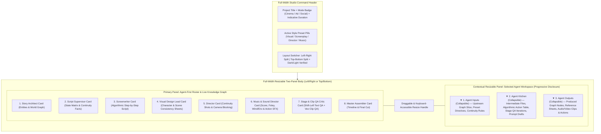

# Implementation Plan: Agent-First Production Studio, Style Presets, Shift-Left QA & Honest Codebase Index

This plan addresses all 9 architectural and product requirements in order while strictly enforcing the repository's coding standards (max 400 non-comment statements per file, max 30 statements per function, strict Python/TypeScript typing, zero raw HTML controls in `frontend/src/`, zero AST clones, and 4-tier isolation).

---

## 1. Honest Codebase Index Checker (`scripts/check_codebase_index.py` & `scripts/generate_codebase_index.py`)

### Goal
Ensure [`CODEBASE_INDEX.json`](file:///usr/local/google/home/sanjeetsahay/projects/veogen/CODEBASE_INDEX.json) and [`CODEBASE_INDEX.md`](file:///usr/local/google/home/sanjeetsahay/projects/veogen/CODEBASE_INDEX.md) never drift when files are added, moved, renamed, deleted, or when exported symbols/tiers change.

### Proposed Changes
- **[NEW] [`scripts/check_codebase_index.py`](file:///usr/local/google/home/sanjeetsahay/projects/veogen/scripts/check_codebase_index.py)**:
  - Computes the live repository index in-memory using [`build_index()`](file:///usr/local/google/home/sanjeetsahay/projects/veogen/scripts/generate_codebase_index.py#L148-L194) and [`render_markdown()`](file:///usr/local/google/home/sanjeetsahay/projects/veogen/scripts/generate_codebase_index.py#L197-L243) (ignoring the volatile `generated_at` timestamp).
  - Compares the live file set and per-file metadata (`path`, `tier`, `lines`, `classes`, `functions`, `endpoints`) against the committed `CODEBASE_INDEX.json` and `CODEBASE_INDEX.md`.
  - Reports exact drift categories:
    - **Added / Unindexed files** (present on disk in tracked roots, missing from index)
    - **Deleted / Moved phantom files** (present in `CODEBASE_INDEX.json`, missing on disk)
    - **Stale symbol / tier / statement count metadata**
  - Supports `--sync` (updates both files in place and logs semantic diff) and `--check` (exits non-zero if any drift is detected).
- **[MODIFY] [`scripts/pre-deploy.sh`](file:///usr/local/google/home/sanjeetsahay/projects/veogen/scripts/pre-deploy.sh)**:
  - Run `python3 scripts/check_codebase_index.py --sync` followed by `python3 scripts/check_codebase_index.py --check` so pre-deploy both refreshes and verifies index honesty.
- **[MODIFY] [`api/tests/test_architecture_and_duplication.py`](file:///usr/local/google/home/sanjeetsahay/projects/veogen/api/tests/test_architecture_and_duplication.py)**:
  - Add a unit test asserting `check_codebase_index.py --check` passes with zero unindexed or phantom files.

---

## 2. Production Frontend Format Modes, Indicative Duration & Zero Prompt Selection

### Goal
Properly differentiate **Cinematic Videos (`movie`)**, **Commercial Ads (`advertizement`)**, and **Social Videos (`social`)** in the Production creation UI, treat selected duration as **indicative pacing** (while story content decides actual length), and ensure no system prompt / schema selector is shown.

### Mode Specifications
| Format Mode | Aspect Ratio / Framing | Indicative Duration Options | Story Pacing Behavior |
| :--- | :--- | :--- | :--- |
| **Cinematic Videos (`movie`)** | Widescreen `16:9` (`horizontal` locked default) | `60s` (~1m), `120s` (~2m), `180s` (3m+ Long-Form) | Multi-scene narrative arc; content determines total scenes & runtime (can exceed 3 minutes). |
| **Commercial Ads (`advertizement`)** | `16:9` (Landscape) or `9:16` (Vertical) | `15s` (Bumper/Spot), `30s` (Standard Commercial) | High-impact hook, product/brand hero showcase, and crisp call-to-action up to ~30 seconds. |
| **Social Videos (`social`)** | `9:16` (Tall/Reels/Shorts default) or `16:9` (Wide) | `30s`, `60s` (~1m), `90s` (1m+ Deep Story) | Fast-paced retention hook; tall or wide; content drives exact length (1+ minutes supported). |

### Proposed Changes
- **[MODIFY] [`frontend/src/types/project.ts`](file:///usr/local/google/home/sanjeetsahay/projects/veogen/frontend/src/types/project.ts)**:
  - Expand `projectSchema` and `Project` with optional preset fields (`visual_style_preset`, `screenplay_style_preset`, `director_style_preset`, `music_style_preset`) and `duration_mode: 'content_driven' | 'indicative'`.
- **[MODIFY] [`frontend/src/components/ads/ProjectForm.tsx`](file:///usr/local/google/home/sanjeetsahay/projects/veogen/frontend/src/components/ads/ProjectForm.tsx)** & **[`frontend/src/components/ads/projects/ProjectFormSections.tsx`](file:///usr/local/google/home/sanjeetsahay/projects/veogen/frontend/src/components/ads/projects/ProjectFormSections.tsx)**:
  - When switching `type` (`movie` | `advertizement` | `social`), automatically set sensible defaults for `orientation` (`16:9` for `movie`, `9:16` for `social`, `16:9` or `9:16` for `advertizement`) and indicative `video_length`.
  - Relabel the duration selector to **Indicative Pacing Target** with helper badge: *"Story content decides final runtime — duration guides scene pacing."*
  - Keep prompt/schema selection completely removed from the user flow.

---

## 3. Role Definitions & Instructional Style Presets (Screenplay, Director, Music, Visual Style)

### Goal
Clearly define the roles of **Screenplay Writer**, **Director**, and **Music Director**, and provide curated style preset groups (without naming real people) plus **Visual Style Presets** that inject structured instructional prompts into the Knowledge Graph (`ProjectMeta` & `StyleGuide`) for the entire production.

### Role Definitions
1. **Screenplay Writer (`screenwriter`)**:
   - **Core Mandate**: Writes the screenplay like a deterministic **algorithm**—clear, sequential step-by-step instructions on what happens on screen.
   - **Rule**: Decides the exact order in which a character acts or interacts with another character or the environment, **strictly one action or interaction at a time**. No bundled multi-action paragraphs or simultaneous conflicting actions.
2. **Director (`director`)**:
   - **Core Mandate**: Translates each algorithmic screenplay beat into concrete cinematography: camera framing, focal length/lens, camera movement, spatial blocking (left/center/right 180-degree axis), lighting progression, and cut transitions.
3. **Music & Soundscape Director (`music`)**:
   - **Core Mandate**: Designs both the musical score AND the complete **foley, environmental ambience, and action-attention sound effects (SFX)**—e.g., footsteps/walking on specific surfaces, wind/breeze rustling, room tone, cloth movement, and crisp diegetic sound accents that pull viewer attention to key on-screen actions.

### Curated Preset Groups (No Real Person Names)

- **[NEW] [`productions_service/storygraph/presets.py`](file:///usr/local/google/home/sanjeetsahay/projects/veogen/productions_service/storygraph/presets.py)** & **[NEW] [`frontend/src/components/ads/projects/stylePresetsConfig.ts`](file:///usr/local/google/home/sanjeetsahay/projects/veogen/frontend/src/components/ads/projects/stylePresetsConfig.ts)**:
  1. **Visual Style Presets (`visual_style_preset`)**:
     - `pixar_3d`: **3D Feature Animation (Pixar-Inspired)** — Subsurface skin scattering, expressive oversized eyes, warm bounced global illumination, tactile Pixar-grade materials.
     - `ghibli_handpainted`: **Hand-Painted Pastoral Anime (Ghibli-Inspired)** — Lush watercolor/gouache backgrounds, gentle wind-blown foliage, warm nostalgic sunlight, expressive hand-drawn linework.
     - `niji_expressive`: **Vibrant Illustrative Anime (Niji Style)** — High-saturation cel shading, dramatic rim lighting, iridescent highlights, dynamic anime illustration aesthetics.
     - `chibi_stylized`: **Super-Deformed Chibi World** — Proportionate 2.5-head stylized characters, pastel tactile surfaces, playful miniature diorama depth-of-field.
     - `manga_anime`: **Kinetic Manga & Cel-Shaded Anime** — Crisp ink contours, high-contrast shadow blocks, kinetic speed-line energy, expressive anime framing.
     - `superhero_blockbuster`: **Cinematic Superhero Blockbuster (Marvel-Scale)** — Anamorphic flare, high-dynamic-range heroic key lighting, epic scale compositions, crisp VFX realism.
     - `indie_arthouse`: **A24 / Indie Arthouse Cinema** — Naturalistic available lighting, intimate 35mm shallow depth of field, muted organic color palette, raw emotional texture.
     - `retro_80s`: **1980s Analog Synth & Practical Cinema** — Anamorphic halation, neon magenta/cyan practicals, warm Kodak 5247 film grain, classic 80s practical atmosphere.
     - `new_hollywood_70s`: **1970s Gritty Film Stock & Zoom Aesthetics** — Heavy 35mm photochemical grain, warm tungsten practicals, split-diopter depth, earthy ochre and amber tones.
     - `mythological_epic`: **Grand Period & Mythological Tapestry** — Golden hour volumetric shafts, ornate artisanal costumes, rich jewel-toned palettes, painterly chiaroscuro.
  2. **Directorial Style Presets (`director_style_preset` — Named by Archetype, Never Real Directors)**:
     - `wonder_spectacle`: **Wonder, Emotional Spectacle & Fluid Tracking** *(Orchestrated Push-Ins, Awe-Struck Reaction Shots, Golden Backlight & Seamless Long-Take Blocking)*
     - `operatic_maximalism`: **Operatic Grandeur & Symmetrical Maximalism** *(Palatial Centered Compositions, Swirling Choreographed Camera, Opulent Color & Emotional Crescendo)*
     - `cerebral_imax_tension`: **Cerebral Time-Puzzle & Large-Format Tension** *(Architectural Scale, Cross-Cut Momentum, Grounded Practical Realism & Relentless Pacing)*
     - `kinetic_wit_chapters`: **Razor-Sharp Tension, Trunk/Low Angles & Sudden Impact** *(Lingering Suspense Hold, Whip-Pans, Extreme Close-Up Inserts & Stylized Standoff Blocking)*
     - `clinical_symmetry`: **Clinical One-Point Perspective & Hypnotic Precision** *(Dead-Center Geometry, Slow Deliberate Steadicam Creep, Practical Light Sources & Unblinking Framing)*
     - `fast_cut_street_rhythm`: **Snap-Zoom Kinetic Caper & Hyper-Edited Rhythm** *(Whip-Cuts, Visual Object Match-Cuts, Snappy Prop Inserts & High-Energy Momentum)*
  3. **Screenplay Writer Style Presets (`screenplay_style_preset`)**:
     - `algorithmic_action_first`: **Pure Algorithmic Visual Storytelling** *(Strict show-don't-tell, atomic step-by-step physical interactions, minimal dialogue, clear cause-and-effect chain)*
     - `tense_sorkin_exchange`: **Rapid-Fire Walk-and-Talk & Subtext** *(Turn-by-turn conversational volleys anchored by deliberate physical micro-actions between lines)*
     - `poetic_minimalist`: **Atmospheric Micro-Gestures & Quiet Observation** *(Deliberate single gestures, tactile object interactions, emotional silence between sparse lines)*
     - `high_stakes_commercial`: **Hook-Problem-Payoff Precision** *(Immediate visual hook in beat 1, clear product/character interaction in beat 2, memorable payoff in beat 3)*
  4. **Music & Soundscape Style Presets (`music_style_preset`)**:
     - `tactile_foley_intimate`: **Hyper-Detailed Foley & Diegetic Realism** *(Foregrounded footsteps, fabric rustle, wind/breeze texture, object clicks, and sparse acoustic underscore)*
     - `brahms_pulse_percussion`: **Ticking-Clock Pulse & Sub-Bass Impact** *(Rhythmic ostinato, sharp metallic action accents, atmospheric pressure drops, and immersive spatial SFX)*
     - `orchestral_wonder`: **Sweeping Symphonic & Lush Environmental Ambience** *(Leitmotif strings/woodwinds balanced with natural breeze, room acoustics, and expressive motion whooshes)*
     - `synthwave_modern_hybrid`: **Analog Synth Arpeggios & Crisp Action Foley** *(Warm analog pads paired with punchy focal sound effects that snap attention to every physical interaction)*
- **[NEW] [`frontend/src/components/ads/projects/ProjectStylePresetSections.tsx`](file:///usr/local/google/home/sanjeetsahay/projects/veogen/frontend/src/components/ads/projects/ProjectStylePresetSections.tsx)**:
  - Shadcn-style interactive preset cards for the 4 categories in the project creation form and editable inside the Studio.

---

## 4 & 9. Agent Prompts & Canonical Consistency Definitions

### Goal
Update all agent system prompts (`productions_service/storygraph/agents/prompts/*.md`), role user prompts (`productions_service/storygraph/agents/role/*.py`), and prompt compilers (`productions_service/storygraph/compile.py`) to strictly enforce the role instructions in #3 and the exact canonical definitions in #9.

### Canonical Definitions Embedded Across Prompts, Schema & Compiler
> [!IMPORTANT]
> Every authoring and QA prompt will include and enforce these three exact definitions:
> - **9.1 Continuity**: *"Continuity is the seamless flow of action, time, and camera movement between consecutive shots. When prompting, align motion direction, object states, and lighting progressions across sequential clips."*
> - **9.2 Character Consistency**: *"Character Consistency means keeping a subject's facial features, body type, and clothing identical across shots. Achieve this by repeating fixed identity descriptors or anchoring prompts with reference images."*
> - **9.3 Scene Consistency**: *"Scene Consistency is preserving the exact environment, architecture, lighting, and visual style throughout a sequence. Maintain it by reusing the same setting, atmosphere, and camera lens keywords in every prompt."*

### Proposed Changes
- **[MODIFY] [`productions_service/storygraph/agents/prompts/screenwriter.md`](file:///usr/local/google/home/sanjeetsahay/projects/veogen/productions_service/storygraph/agents/prompts/screenwriter.md)** & **[`productions_service/storygraph/agents/role/screenwriter.py`](file:///usr/local/google/home/sanjeetsahay/projects/veogen/productions_service/storygraph/agents/role/screenwriter.py)**:
  - Enforce **Algorithmic Screenplay Writing**: break every scene into ordered `interaction_steps` (`Step 1 -> Step 2 -> Step 3`), where each step specifies `actor_id`, `target_id` (another character, prop, or environment element), `single_action` (strictly one action at a time), `object_state_after`, and `sound_trigger`.
  - Inject selected `screenplay_style_preset` and `visual_style_preset` instructions.
- **[MODIFY] [`productions_service/storygraph/agents/prompts/director.md`](file:///usr/local/google/home/sanjeetsahay/projects/veogen/productions_service/storygraph/agents/prompts/director.md)** & **[`productions_service/storygraph/agents/role/director.py`](file:///usr/local/google/home/sanjeetsahay/projects/veogen/productions_service/storygraph/agents/role/director.py)**:
  - Enforce 9.1 Continuity (motion vector alignment, object state handoff, lighting progression across consecutive clips), 9.2 Character Consistency (fixed identity descriptors + reference image anchoring), and 9.3 Scene Consistency (repeating exact setting, atmosphere, and camera lens keywords in every shot).
  - Map 1-to-1 with the Screenwriter's algorithmic steps so no shot crams multiple sequential character interactions into a single clip.
  - Inject selected `director_style_preset` and `visual_style_preset` instructions.
- **[MODIFY] [`productions_service/storygraph/agents/prompts/music.md`](file:///usr/local/google/home/sanjeetsahay/projects/veogen/productions_service/storygraph/agents/prompts/music.md)** & **[`productions_service/storygraph/agents/role/music.py`](file:///usr/local/google/home/sanjeetsahay/projects/veogen/productions_service/storygraph/agents/role/music.py)**:
  - Require explicit design of:
    1. `foley_cues`: Character movement sounds (footsteps/walking pace & surface texture, cloth movement, hand-to-prop contact).
    2. `environment_sfx`: Wind/breeze, room tone, weather, spatial background atmosphere.
    3. `action_focus_sfx`: Sound effects that pull viewer attention to a specific on-screen action or state change.
    4. `score_cue`: Musical underscore that complements without masking diegetic foley/dialogue.
  - Inject selected `music_style_preset` instructions.
- **[MODIFY] [`productions_service/storygraph/compile.py`](file:///usr/local/google/home/sanjeetsahay/projects/veogen/productions_service/storygraph/compile.py)** & **[`productions_service/storygraph/templates/shot_prompt.j2`](file:///usr/local/google/home/sanjeetsahay/projects/veogen/productions_service/storygraph/templates/shot_prompt.j2)**:
  - Automatically inject:
    - Fixed character identity descriptors (`9.2 Character Consistency`)
    - Locked scene setting, atmosphere, and camera lens keywords (`9.3 Scene Consistency`)
    - Previous shot exit motion direction, object states, and lighting progression (`9.1 Continuity`)
    - Active Visual & Directorial preset directives
    - Diegetic foley, environmental ambience, and action-focus SFX cues for Veo audio-video synthesis.

---

## 5. Shift-Left Stage QA Agent After Each Authoring Step

### Goal
Because reviewing and fixing **text** is orders of magnitude cheaper than regenerating **images** or **videos**, run a dedicated **Stage QA Agent** immediately after each authoring step (`S1_EXTRACT`, `S2_SCREENPLAY`, `S3_DESIGN`, `S4_SHOTS`, `S5_MUSIC`) and iterate automatically to fix any violations before advancing.

```mermaid
flowchart LR
    S1["S1: Story Architect & Supervisor"] --> QA1{"Stage QA: S1"}
    QA1 -- "Fix Text/Graph" --> S1
    QA1 -- "Pass" --> S2["S2: Screenwriter (Algorithmic Steps)"]
    S2 --> QA2{"Stage QA: S2"}
    QA2 -- "Fix Bundled Actions / Order" --> S2
    QA2 -- "Pass" --> S3["S3: Design Lead (Identity & Lens Lock)"]
    S3 --> QA3{"Stage QA: S3"}
    QA3 -- "Fix Consistency Anchors" --> S3
    QA3 -- "Pass" --> S4["S4: Director (Continuity & Shot Plan)"]
    S4 --> QA4{"Stage QA: S4"}
    QA4 -- "Fix Continuity / Lens / Presets" --> S4
    QA4 -- "Pass" --> S5["S5: Music & Soundscape (Foley/SFX)"]
    S5 --> QA5{"Stage QA: S5"}
    QA5 -- "Fix Missing Foley/Env SFX" --> S5
    QA5 -- "Pass" --> S6["S6: Veo Render & Clip QA"]
```

### Proposed Changes
- **[NEW] [`productions_service/storygraph/agents/stage_qa.py`](file:///usr/local/google/home/sanjeetsahay/projects/veogen/productions_service/storygraph/agents/stage_qa.py)** & **[NEW] [`productions_service/storygraph/agents/prompts/stage_qa.md`](file:///usr/local/google/home/sanjeetsahay/projects/veogen/productions_service/storygraph/agents/prompts/stage_qa.md)**:
  - Implements `run_stage_qa_and_remediate(graph, state, stage_name, run_stage_fn, max_iterations=2)`:
    - **After `S1_EXTRACT`**: Verifies all characters, locations, props, environment details, fixed identity descriptors (9.2), and scene atmosphere/lens locks (9.3) are extracted into the Knowledge Graph.
    - **After `S2_SCREENPLAY`**: Verifies the screenplay is written as an algorithm (`interaction_steps` ordered sequentially, strictly **one action/interaction at a time**, explicit character-to-character and character-to-environment interactions, and adherence to `screenplay_style_preset`).
    - **After `S3_DESIGN`**: Verifies every character, location, and key prop has locked identity descriptors and reference sheets matching `visual_style_preset`.
    - **After `S4_SHOTS`**: Verifies every shot honours **9.1 Continuity** (motion direction alignment, object state progression, lighting progression across consecutive shots), **9.2 Character Consistency** (fixed identity descriptors + reference anchors), **9.3 Scene Consistency** (same setting, atmosphere, and camera lens keywords repeated), and `director_style_preset`.
    - **After `S5_MUSIC`**: Verifies every scene/shot includes explicit foley (walking, footsteps, contact), environmental sounds (wind/breeze, ambience), and action-attention SFX matching `music_style_preset`.
  - Records every QA pass, critique, and remediation diff in `graph.kitchen_logs[agent_id]` so the user can inspect the QA iterations in the Studio's **Kitchen** view.
- **[MODIFY] [`productions_service/storygraph/pipeline/runner.py`](file:///usr/local/google/home/sanjeetsahay/projects/veogen/productions_service/storygraph/pipeline/runner.py)**:
  - Delegate post-step verification of `S1_EXTRACT` through `S5_MUSIC` to `run_stage_qa_and_remediate` while keeping `pipeline/runner.py` well below the 400-statement limit.

---

## 6. Knowledge Graph as Single Source of Truth for All Minute Details

### Goal
Store all minute details—step-by-step character actions, character-to-character & character-to-environment interactions, object state changes, foley/environmental SFX, continuity vectors, and style presets—directly in `StoryGraph` as the single source of truth.

### Proposed Changes
- **[MODIFY] [`productions_service/storygraph/schema.py`](file:///usr/local/google/home/sanjeetsahay/projects/veogen/productions_service/storygraph/schema.py)** (and **[NEW] [`productions_service/storygraph/presets.py`](file:///usr/local/google/home/sanjeetsahay/projects/veogen/productions_service/storygraph/presets.py)**):
  - Add `InteractionStep` model:
    - `step_index: int`
    - `actor_id: str`
    - `interaction_type: Literal["character_to_character", "character_to_environment", "character_to_prop", "solo_action"]`
    - `target_id: str` (character ID, prop ID, or environment element)
    - `action_instruction: str` (atomic single action)
    - `environment_reaction: str` (e.g., dust rising, door creaking, leaves rustling)
    - `object_state_after: str`
    - `foley_sfx_cue: str` (e.g., `"crisp leather footsteps on wet cobblestone"`, `"soft breeze through tall grass"`)
  - Enrich `Scene`:
    - `interaction_steps: List[InteractionStep]` (the algorithmic step-by-step sequence)
    - `atmosphere_keywords: List[str]` & `locked_lens_keywords: List[str]` (`9.3 Scene Consistency`)
    - `lighting_progression: str` (`9.1 Continuity`)
    - `environmental_sounds: List[str]` (wind/breeze, room tone, ambient soundscape)
  - Enrich `Shot`:
    - `step_indices: List[int]` (links shot to exact algorithmic `InteractionStep`s)
    - `motion_direction: str`, `entry_object_states: Dict[str, str]`, `exit_object_states: Dict[str, str]`, `lighting_state: str` (`9.1 Continuity`)
    - `scene_consistency_keywords: List[str]` (`9.3 Scene Consistency`)
    - `foley_cues: List[str]`, `environment_sfx: List[str]`, `action_focus_sfx: List[str]`
  - Enrich `StyleGuide` & `ProjectMeta`:
    - `visual_style_preset: str`, `screenplay_style_preset: str`, `director_style_preset: str`, `music_style_preset: str`
    - `preset_instructions: Dict[str, str]` (the resolved instructional prompts for the entire production)
  - Add `AgentWorkspaceArtifact` (`kitchen_artifacts` on `StoryGraph`) to persist each agent's **Inputs**, **Kitchen** (intermediate reasoning, algorithmic tables, Stage QA iterations, prompt drafts), and **Outputs**.
- **[MODIFY] [`productions_service/storygraph/tools/write_tools/scenes_and_script.py`](file:///usr/local/google/home/sanjeetsahay/projects/veogen/productions_service/storygraph/tools/write_tools/scenes_and_script.py)** & **[`shots_and_assets.py`](file:///usr/local/google/home/sanjeetsahay/projects/veogen/productions_service/storygraph/tools/write_tools/shots_and_assets.py)**:
  - Update write tools so Screenwriter, Director, and Music Director populate `interaction_steps`, continuity fields, and foley/environment SFX directly in the Knowledge Graph.

---

## 7 & 8. Redesign Production Studio: Shadcn Agent-First View + Full-Width Two-Panel Resizable Layout

### Goal
Replace the pipeline-step mental model with an **Agent-First Studio** using a **full-width two-panel layout** that can switch between **Left / Right** (horizontal split) and **Top / Bottom** (vertical split). The right/bottom contextual panel is **resizable** and displays the selected Agent's **Inputs**, **Kitchen** (intermediate artifacts), and **Outputs** as **collapsible** progressive-disclosure sections.

### Proposed Frontend Architecture (Modular Files < 400 Statements Each)
- **[MODIFY] [`frontend/src/types/storygraph.ts`](file:///usr/local/google/home/sanjeetsahay/projects/veogen/frontend/src/types/storygraph.ts)**:
  - Add TypeScript interfaces for `InteractionStep`, `AgentCardId`, `AgentWorkspaceView` (`inputs`, `kitchen`, `outputs`), `StageQaReport`, and `StylePresetSelection`.
- **[NEW] [`frontend/src/components/ads/storygraph/agentRosterAdapter.ts`](file:///usr/local/google/home/sanjeetsahay/projects/veogen/frontend/src/components/ads/storygraph/agentRosterAdapter.ts)**:
  - Pure deterministic adapter transforming `StoryGraph` + pipeline status into the 8 **Agent Cards**, computing each agent's status (`idle`, `cooking`, `qa_review`, `ready`, `needs_attention`), summary metrics, **Inputs**, **Kitchen** intermediate artifacts, and **Outputs**.
- **[NEW] [`frontend/src/components/ads/storygraph/AgentRosterGrid.tsx`](file:///usr/local/google/home/sanjeetsahay/projects/veogen/frontend/src/components/ads/storygraph/AgentRosterGrid.tsx)**:
  - Renders the Shadcn-style Agent Cards in the Left/Top primary panel with progressive disclosure: clean role title, active preset badge, status indicator, 1-line live digest, and quick counts of Inputs / Kitchen items / Outputs.
- **[NEW] [`frontend/src/components/ads/storygraph/AgentContextPanel.tsx`](file:///usr/local/google/home/sanjeetsahay/projects/veogen/frontend/src/components/ads/storygraph/AgentContextPanel.tsx)**:
  - The Right/Bottom contextual panel with three Shadcn collapsible sections (`Collapsible` / accordion pattern):
    1. **Inputs (`Collapsible`)**: Upstream Knowledge Graph entities, active style preset prompt instructions, and 9.1/9.2/9.3 consistency rules fed into the agent.
    2. **Kitchen (`Collapsible`)**: Intermediate work-in-progress files & artifacts—e.g., the Screenwriter's algorithmic `InteractionStep` table (character-to-character & environment steps), Script Supervisor's state transitions, Director's continuity alignment matrix & compiled Jinja2 prompts, Music Director's foley/wind/action SFX cue sheets, and the **Shift-Left Stage QA** review log & auto-fix iterations.
    3. **Outputs (`Collapsible`)**: Finalized scenes, character/location reference sheets, rendered shot clips, audio stems, and contextual edit/re-run controls.
- **[NEW] [`frontend/src/components/ads/storygraph/ResizableSplitStudioLayout.tsx`](file:///usr/local/google/home/sanjeetsahay/projects/veogen/frontend/src/components/ads/storygraph/ResizableSplitStudioLayout.tsx)**:
  - Full-width two-panel container supporting:
    - **Layout Mode Toggle**: `'horizontal'` (Left & Right panels) or `'vertical'` (Top & Bottom panels), persisted in local state/storage.
    - **Pointer/Touch Drag Resize Handle** + preset split ratios (`35/65`, `50/50`, `65/35`) with smooth mobile fallback (stacking / drawer-friendly adaptive view on small viewports).
- **[MODIFY] [`frontend/src/components/ads/StoryGraphStudioPanel.tsx`](file:///usr/local/google/home/sanjeetsahay/projects/veogen/frontend/src/components/ads/StoryGraphStudioPanel.tsx)** & **[`frontend/src/components/ads/RefinePromptView.tsx`](file:///usr/local/google/home/sanjeetsahay/projects/veogen/frontend/src/components/ads/RefinePromptView.tsx)**:
  - Replace the legacy 3-column pipeline step view with the new full-width Agent-First `ResizableSplitStudioLayout` (`AgentRosterGrid` + `AgentContextPanel`), verified in both **light and dark modes** and responsive across mobile/tablet/desktop breakpoints.

---

## Verification & Quality Gates

1. **Honest Codebase Index Verification**:
   - Run `python3 scripts/check_codebase_index.py --sync` and `python3 scripts/check_codebase_index.py --check`.
   - Test adding/moving/deleting a dummy file in a unit test to confirm `check_codebase_index.py --check` immediately catches the discrepancy.
2. **Backend Unit & Integration Tests (`scripts/unit-tests.sh`)**:
   - Add unit tests in `api/tests/` covering:
     - Style preset resolution (`visual_style_preset`, `screenplay_style_preset`, `director_style_preset`, `music_style_preset`) into `StoryGraph` instructional prompts.
     - Algorithmic `InteractionStep` schema validation (one action at a time, character/environment targets, foley cues).
     - Shift-Left `StageQAAgent` detecting and remediating bundled actions, missing foley/environmental SFX, or violated 9.1/9.2/9.3 consistency rules after `S1`–`S5`.
     - Prompt compilation (`compile.py`) embedding 9.1 Continuity, 9.2 Character Consistency, 9.3 Scene Consistency, and foley/SFX cues.
3. **Static Architecture, Component & Coding Standards Gate (`scripts/pre-deploy.sh`)**:
   - Verify zero violations in `check_architecture.py`, `check_components.py` (zero raw HTML `<button>`, `<input>`, etc.), `check_coding_standards.py` (all files $\le 400$ statements, all functions $\le 30$ statements), `check_codebase_index.py`, `ruff`, and Next.js SSR build.
