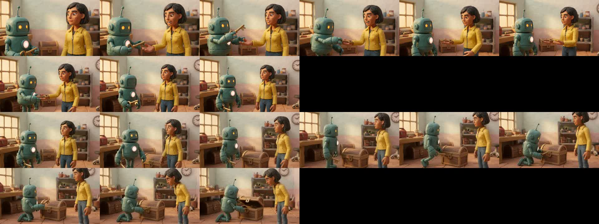
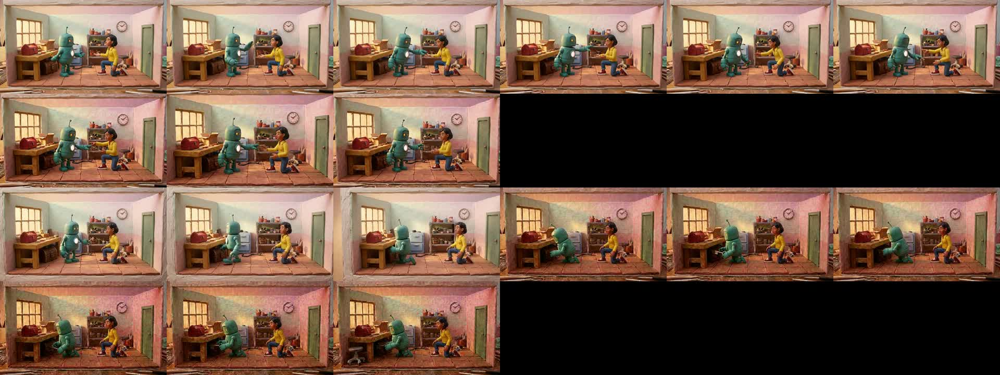
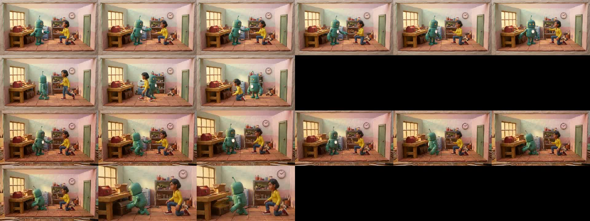
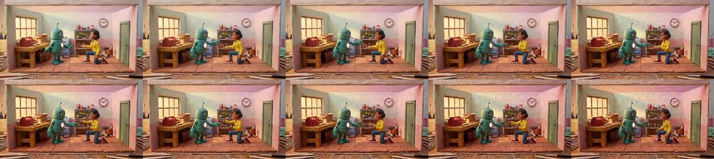
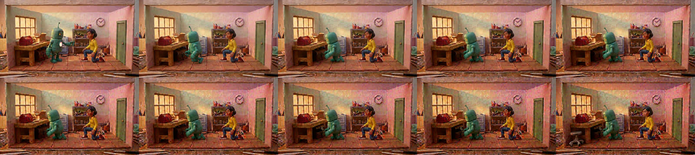

# Keyframe render strategies — v1 (A/B/C) and v2 (D1/D2 anchored)

## v2 update: `keyframe_anchored` is the new default

Production now has an **S8_KEYFRAMES** stage (`storygraph/keyframes/stage`). It runs between
S7 compile and S8 render and writes N+1 graph-derived keyframes per N-second clip. The last
keyframe of clip k is the first keyframe of clip k+1 (same asset). Frames are VLM-checked
against graph state and against the previous keyframe, with up to 2 regenerations, after which
the shot is flagged for manual edit. Each set is stored as a versioned `KeyframeSet` in
Firestore, with the images in GCS. S8 render consumes the approved sets.

Two single-call strategies were added and tested on the same scn_008 shots, with the same
keyframes, 2 seeds each (8 Omni requests):

* **D1 `keyframe_anchored`**: `<FIRST_FRAME>`=kf0 and `<LAST_FRAME>`=kfN. The 4 middle
  keyframes (t=2,4,5,7) are passed as `IMAGE_REF_k`. Each is labelled *"STATE REFERENCE at
  t=Xs … not a shot to insert"*. The spec prompt is shortened (~200 words vs ~225 hybrid)
  because the images carry identity, wardrobe and props.
* **D2 `keyframe_anchored_text`**: first and last keyframes only. The middle states become
  timeline text derived from the plan. With no middle images, nothing can be flashed in.

| variant | chest dup frames ↓ | cabinet visible ↑ | beats done ↑ | hard cuts ↓ | eval overall ↑ | gate pass ↑ | shot hand-off ↑ |
|---|---|---|---|---|---|---|---|
| A_direct | 0.25 | 0.00 | 0.75 | 0.0 | 0.81 | 2/4 | 0.90 |
| B_interp | 0.00 | 1.00 | 0.63 | 0.5 | 0.64 | 0/4 | 0.80 |
| C_animatic | 0.08 | 1.00 | 0.38 | 0.25 | 0.65 | 0/4 | 0.20 |
| **D1_anchored** | **0.00** | **1.00** | **0.75** | **0.0** | **0.86** | **3/4** | 0.70 |
| D2_anchored_text | 0.00 | 1.00 | 0.63 | 0.0 | 0.78 | 0/4 | 0.90 |

All variants scored 1.00 on outfit stability and identity presence.

* **Inserts and flashes.** D1 produced no hard cuts and no `hard_cut` or `style_drift`
  defects, so the explicit state-reference label prevented the insert seen in B. D2 also had
  0 cuts.
* **D1 vs A.** D1 keeps A's action adherence (0.75) while removing the drift: 0 duplicate
  chests, the cabinet always present, and the higher eval and gate scores. Its one gate
  failure (shot 1, s1) is the brass key popping into Pip's hand at 1.5 s
  (`temporal_consistency`).
* **D2** stays continuous but under-acts. The key hand-off and the unlock are judged not
  done, so it fails `action_adherence`.
* **Hand-off.** D1 s1 scored 0.4 from small robot-detail differences (eye colour, antenna
  tip); D1 s0 scored 1.0. Both clips start on the same shared keyframe, so the remaining
  differences come from Omni, not the plan.

**Decision.** `video.render_strategy: keyframe_anchored` (D1) is the default in
`config.py` and `default.yaml`. Direct no longer wins on action: D1 ties A on beats done and
beats it on eval, gate and drift. All other strategies remain selectable. Sample size is small
(4 clips per variant, one scene), so the golden set should be re-run with S8_KEYFRAMES enabled.

---

## v1 (original A/B/C comparison)

**Question.** Independent 8–10 s Omni clips drift (outfits change, duplicate chests, the blue
cabinet vanishes). Does driving every second from the StoryGraph — 1 fps graph-correct
keyframes that Omni only animates between — fix it?

**Answer (v1).** Partly. Keyframes **fix object permanence and layout** (0 duplicate chests,
blue cabinet visible in 100 % of frames vs 0 % for direct), but **Omni loses action adherence**
when it is pinned to keyframes, and the eval gate prefers direct. The v1 decision was to keep
`direct` as the default and to iterate on `keyframe_interp`; `animatic_edit` was rejected.
v2 above supersedes this.

## Method

* **Scene.** `p-0irbygdv / scn_008` (2 shots × 9 s, Pip + Ava, brass key, wooden chest
  under the workbench, blue cabinet in the room). This is the scene with known chest drift.
  Exports: `…/bc0d8aa7…/scratch/prods/p-0irbygdv/` (refreshed 2026-10-22 10:59).
* **Plan.** `storygraph/keyframes/plan` built a 1 fps plan per shot (t = 0..9) from the graph:
  clip window, per-beat snapshots, wardrobe from appearances. Lint: 0 issues per clip and
  0 scene hand-off issues. The planner surfaced a graph gap: the chest has no `location` fact
  until evt_017, so it "appeared" at t = 3; `plan/permanence.py` now back-fills such set
  pieces from t = 0.
* **Keyframes.** `gemini-nano-banana-2.1` (Vertex `aug18-25-3`): t = 0 from identity sheets +
  location plate; t > 0 = edit of t − 1 by the delta; shot 2 t = 0 = re-framing edit of shot
  1's final keyframe. `gemini-3.8-flash` checked each one; up to 2 retries. 39 image
  generations in total (shot 1: 10; shot 2 v1: 16; shot 2 v2: 13).
* **Variants** (same production `RenderPackage`: same refs, labels, safety profile):
  * **A_direct**: the current hybrid prompt. Shot 2 binds shot 1's last frame (production).
  * **B_interp**: `<FIRST_FRAME>`/`<LAST_FRAME>` segments every 3 s (0-3, 3-6, 6-9),
    rendered in parallel, trimmed and stitched; identity sheets as `IMAGE_REF_k`.
  * **C_animatic**: 1 fps animatic (9 s) as `<VIDEO_0>` + identity refs, short prompt.
  * 2 samples each. **20 Omni requests** (A 4, B 12, C 4), 0 fallbacks, no auth failures
    (the default ADC had expired, so the quota ADC file was used).
* **Scoring.** (1) The production eval engine (`python -m storygraph.eval.run`, same as the
  S9 critic; spec = the shot's compiled spec; `--prev` = the same chain's previous clip).
  (2) Our own 1 fps frame judge (`gemini-3.1-pro-preview`): per-frame counts of chest and
  cabinet, character presence/outfit, beats done. (3) A hand-off judge comparing the last
  frame of shot 1 with the first frame of shot 2. Code: `storygraph/experiments/keyframe_ab/`.

## Results (means over 4 clips per variant; per-clip data in `keyframe_strategy_v1/`)

| variant | chest dup frames ↓ | cabinet visible ↑ | outfit stable ↑ | beats done ↑ | hard cuts ↓ | eval overall ↑ | gate pass ↑ | shot hand-off ↑ |
|---|---|---|---|---|---|---|---|---|
| A_direct | 0.25 | 0.00 | 1.00 | **0.75** | **0.0** | **0.81** | **2/4** | **0.90** |
| B_interp | **0.00** | **1.00** | 1.00 | 0.63 | 0.5 | 0.64 | 0/4 | 0.80 |
| C_animatic | 0.08 | **1.00** | 1.00 | 0.38 | 0.25 | 0.65 | 0/4 | 0.20 |

Identity was present in every frame and no outfit changed in any variant (1.00 everywhere),
so in this scene outfit drift is not what separates the strategies.

### What happened

* **A_direct** follows the action best: the key hand-off happens, and Pip kneels and opens the
  chest. But it re-imagines the room every time. Shot 2 s0 shows **three chests** (eval:
  `extra_object Wooden Chest x3`, chest pops in at 1.5 s). In s1 the chest teleports onto the
  bench. The blue cabinet never appears (MS/MLS framings crop to the bench). Both shot 2
  clips fail the hard gates.
* **B_interp** keeps the graph's room: the same bench, one chest under it and the cabinet in
  every frame, with clean hand-offs (0.8). Its failures come from the method itself:
  1. **Small motion between keyframes.** The edited keyframes move little (an arm, a kneel),
     so Omni interpolates gentle motion and the eval marks the hand-off beats `step_not_done`.
  2. **Reference sheet flashed as a frame.** In one segment Omni rendered an `IMAGE_REF`
     sheet as an insert (hard cut at 2.79 s). With both frames bound, the identity refs are
     redundant and risky.
  3. **Dialogue dropped.** Segment prompts carry no lines, so the eval reports a missing line
     and unscripted speech.
  4. **Keyframe colour drift.** The edit chain slowly shifts toward pink/saturated colours,
     and Omni carries that over.
  5. **Camera not followed.** Keyframes keep one wide framing, so `MLS/low/track` is lost.
* **C_animatic**: Omni treats the animatic as loose guidance, not as frames to keep.
  Characters swap sides, Ava walks to the door, the key is handed back, and one sample
  morphs the cardboard box into a second chest. The worst hand-off score (0.2) and the
  worst action score.

### Keyframe quality (renderer)

* Shot 1: 10/10 keyframes passed the VLM check (one retry at t = 0, one reused frame).
* Shot 2 v1 (`keyframe_strategy_v1/shot_scn_008_02__keyframes_v1_role_swap.jpg`): **role
  swap**. The edit made Ava, not Pip, kneel at the chest. The v1 check (counts, presence,
  outfit) passed it. Added a per-character `matches_pose` check plus "X keeps the same pose"
  edit lines. v2 re-render: Pip kneels and Ava stays (13 generations).

## Examples

| | |
|---|---|
| A_direct s0 (shots 1+2) |  |
| B_interp s0 |  |
| C_animatic s0 |  |
| keyframes shot 1 |  |
| keyframes shot 2 (v2) |  |

## Recommendation

1. **Keep `direct` as the production default.** It is the only variant that passes gates.
2. **Do not pursue `animatic_edit`.** Omni's edit mode re-stages the action instead of
   following the source.
3. **Iterate `keyframe_interp`.** It is the only strategy that removed the chest/cabinet
   drift. Next experiment (v2), in order of expected impact:
   * put the clip's dialogue lines and the per-segment beat text into segment prompts;
   * **drop `IMAGE_REF` sheets for interp segments** (both frames already carry identity);
   * make the keyframe poses wider (key poses at beat start/end, not 1 s micro-edits)
     with stride = beat boundaries instead of a fixed 3 s;
   * re-anchor colour: edit from keyframe 0 plus the delta-so-far, or add a histogram match;
   * render keyframes in the shot's framing (honour `CameraSpec`).
4. **Cheap hybrid to test alongside v2:** direct hybrid prompt plus `<FIRST_FRAME>` = graph
   keyframe 0 (one image, one Omni call). This puts the graph's set dressing into the first
   frame and keeps direct's action quality.
5. Beyond rendering: graph authors should state static set pieces at scene 1 (the planner's
   back-fill only patches over the missing `location` facts).

## Reproduce

```bash
# from productions_service/, GOOGLE_APPLICATION_CREDENTIALS set, GCS_BUCKET=<media bucket>
python -m storygraph.experiments.keyframe_ab --export-dir <export> --project-id p-0irbygdv \
  --scene scn_008 --out <out> --stage render --samples 2 --stride 3   # keyframes + clips
python -m storygraph.experiments.keyframe_ab ... --stage judge         # eval + judge + report
```

Keyframes, animatics and segment media are stored under `gs://<bucket>/kf_experiments/`
(never production paths). Keyframes are versioned `Asset(kind="keyframe")` records.
