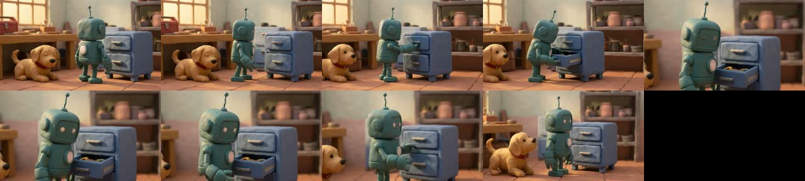
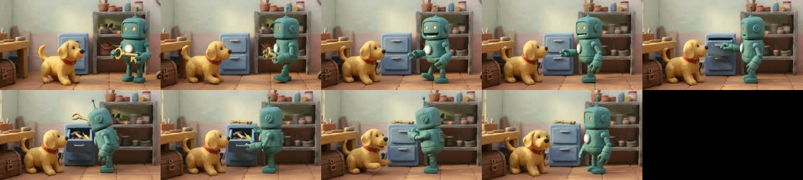
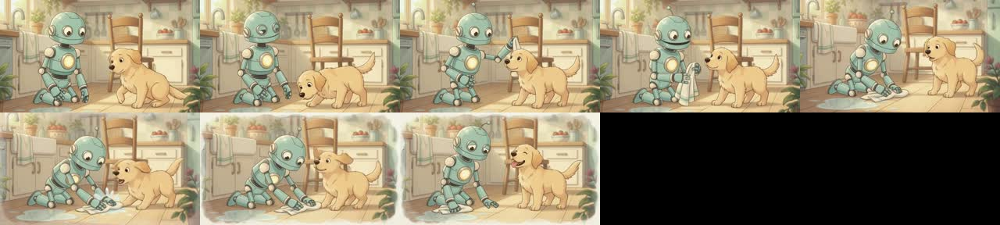
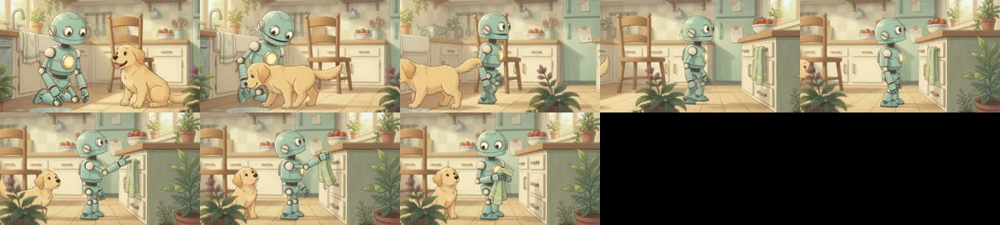
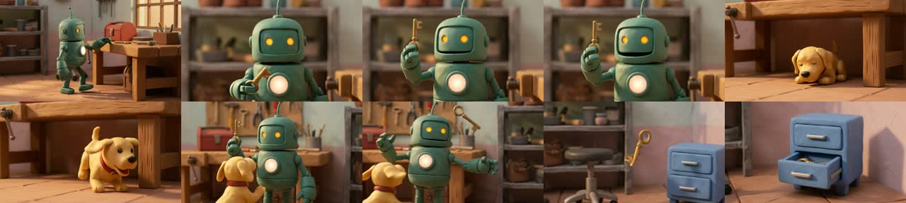
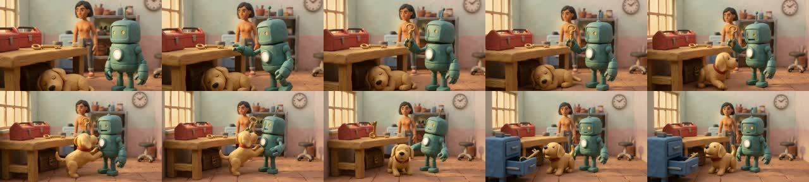
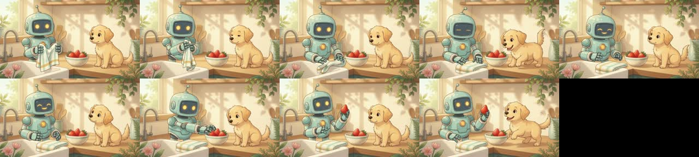
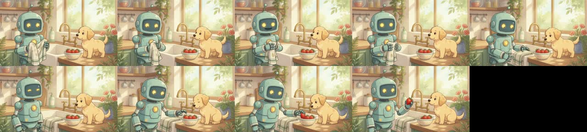

# Prompt-format A/B v1 — is our compiled prompt a cause of Gemini Omni failures?

**Model** `gemini-omni-1.1-flash-preview` (Vertex, `aug18-25-3`, global) · **Date** 2026-10-20 ·
**Renders** 48 (all primary rung, 0 provider failures) · **Est. cost** ≤ $42.60 (upper bound,
$0.10/s @720p list price; clips were 360p) · **Code** `productions_service/storygraph/experiments/prompt_ab/`

## TL;DR

- **The prompt format is a real but secondary cause.** With the same images, first frame,
  duration and resolution, the production JSON spec (V1) scored **0.85** overall. The hybrid
  prompt (V3) scored **0.93** (+0.07, 95% CI [+0.03, +0.13], 6 of 8 cases better). Gate pass
  went from **12% to 38%**. Pure prose (V2) scored 0.88 (+0.03, CI crosses 0).
- **The largest effect is the single-take directive, not prose vs JSON.**
  - Every prompt that said *"Single continuous unbroken shot with no scene cuts."* (V2/V3)
    had **0 ffmpeg-detected cuts in 24 renders**.
  - V1 (the `single_continuous_take` token inside JSON) had cuts in **3 of 14** renders.
  - V4 (no directive) had cuts in **7 of 8** renders.
- **Omni speaks the scripted dialogue correctly in every format.** Transcript similarity
  was 0.99 for all variants, including the Hindi lines. Every `line_missing` failure on
  p-0irbygdv was a **critic bug**, not a model failure (see §6).
- **What remains is Omni's limit plus spec-content problems.** Multi-object physics (c8)
  stayed at 0.63–0.80 in every format. Several failures trace to our spec contents, not its
  format: contradictory object end states, truncated identity text, prop lists that are too
  long. Seed-to-seed noise (mean |Δoverall| 0.09–0.11) is about the size of the format effect.

## 1. Method

**Shots.** We picked 8 cases from 2 projects. All use their deployed compiled specs,
unchanged.

| case | project / shot (attempt) | difficulty probe | refs | first frame |
|---|---|---|---|---|
| c1_walk | p-zyt0jprz / 001_01 (4) | locomotion: push door, step in, close door | 6 | – |
| c2_prop | p-zyt0jprz / 005_01 (4) | small props: fold towel, pick **one** strawberry from bowl | 6 | – |
| c3_twochar | p-zyt0jprz / 005_02 (2) | two-character interaction: feed strawberry, scratch ears | 6 | – |
| c4_dialogue | p-0irbygdv / 003_01 (6) | English dialogue + drawer open/close | 5 | – |
| c5_closeup | p-zyt0jprz / 004_03 (4) | CU: wipe puddle with towel | 6 | – |
| c6_chained | p-zyt0jprz / 004_02 (3) | continuity-chained (`<FIRST_FRAME>` = last frame of approved 004_01) | 5 | ✔ |
| c7_ws_enter | p-0irbygdv / 001_01 (6) | WS entrance, carry box, remove key, dialogue | 5 | – |
| c8_physics | p-0irbygdv / 002_01 (5) | key bumped, arcs, caroms, lands in drawer (3 subjects) | 6 | – |

**Control.** Each variant goes through the production `GeminiVideoGenerator.generate`
(`adapters/gemini_video.py` → `adapters/omni/*`), using a `RenderPackage` that is identical
except for `compiled_prompt`. That keeps the same `[# Sources/References]` header,
reference order, captions, first-frame tag, 360p resolution and duration. Every primary
request text is saved under `scratch/ab/requests/`. `cases.binding_mismatches` confirmed
that every spec `IMAGE_REF_k` token points at the image actually sent (0 mismatches).
Omni has no seed, so a "sample" is an independent re-render.

**Variants** (`variants/builders.py`). Average words before the image captions are shown
in brackets.
- **V1_json** [420]: the production compact `OmniClipSpec` JSON.
- **V2_prose** [305]: written to the Omni prompt guide, in this order:
  1. single-take directive and style
  2. setting
  3. tagged characters with identity text
  4. counted props
  5. opening state
  6. `[a-bs]` timecoded beats, with dialogue inside the beat it follows
  7. camera
  8. sound design
  9. short negatives
- **V3_hybrid** [178]: one prose paragraph (single take, style, ordered beats with no
  timecodes, no dialogue), followed by a minimal block:
  - `CHARACTERS` (tag + screen side)
  - `OBJECTS (each exactly one; never duplicated, never disappears)` (tag, start/end, holder)
  - `SETTING`
  - `CAMERA` (plain words)
  - `DIALOGUE` (after beat n, speaker, language, voice, quoted line)
- **V4_minimal** [54]: one paragraph with actions and dialogue only, and ref tags on first
  mention.

**Budget.** 8 cases × (V1 ×2, V2 ×2, V3 ×1, V4 ×1) = 48 renders. 46 were scored. Two V1
samples (c1 s0, c6 s0) could not be scored because Vertex quota ran out and then
credentials expired. Both cases still have one V1 sample.

**Scoring.** Every render is judged against the case's **V1 spec**, so all variants share
the same ground truth.
- **Deployed eval engine** (`storygraph.eval.engine`): critic VLM, metrics and gate are
  unchanged. Its transcriber was swapped for `gemini-3.1-pro-preview` because of the bug in
  §6. Columns `*.eval`.
- **Independent checks** (`frames.py`, `frame_judge.py`):
  - ffmpeg 3 fps frames
  - scene-score hard-cut detection (`cuts.ffmpeg`, threshold 0.35)
  - a separate checklist judge over the 3 fps frames plus identity refs (`*.frames`). It
    reports beats done, max instances per object and vanish/holder errors, a match score per
    character, camera match, and cuts.
  - free-text transcription scored by char similarity to each scripted line
    (`dialogue.transcript`)

## 2. Results (means over cases; samples averaged within case first)

| dimension | V1_json | V2_prose | V3_hybrid | V4_minimal |
|---|---|---|---|---|
| action adherence (engine) | 0.69 | 0.81 | **0.92** | 0.71 |
| action adherence (frames judge) | 0.65 | 0.59 | **0.90** | 0.81 |
| object permanence (engine) | 0.81 | 0.79 | **0.90** | 0.54 |
| object permanence (frames judge) | 0.53 | 0.55 | **0.78** | 0.41 |
| character consistency (engine) | **0.95** | 0.90 | 0.93 | 0.69 |
| character consistency (frames judge) | **0.95** | 0.91 | 0.92 | 0.91 |
| camera adherence (engine) | 0.79 | **0.88** | **0.88** | 0.42 |
| camera (frames judge) | 0.31 | 0.56 | **0.62** | 0.00 |
| temporal consistency (engine) | 0.76 | **0.88** | **0.88** | 0.44 |
| no hard cut (ffmpeg) | 0.81 | **1.00** | **1.00** | 0.12 |
| no hard cut (frames judge) | 0.75 | **0.94** | 0.88 | 0.00 |
| script adherence (engine) | 0.80 | 0.88 | **0.94** | 0.83 |
| dialogue transcript similarity | 0.99 | 0.99 | 0.99 | 0.99 |
| **overall (engine)** | 0.85 | 0.88 | **0.93** | 0.74 |
| **gate passed** | 0.12 | 0.19 | **0.38** | 0.00 |

**Paired Δ vs V1** (mean [95% bootstrap CI over 8 cases], case wins/losses). Full tables,
including per-case breakdowns, are in [tables.md](prompt_ab_v1/tables.md).

| dimension | V2 − V1 | V3 − V1 | V4 − V1 |
|---|---|---|---|
| overall | +0.03 [−0.02,+0.08] 5W/2L | **+0.07 [+0.03,+0.13] 6W/2L** | **−0.11 [−0.18,−0.05] 1W/7L** |
| action (engine) | +0.12 [+0.00,+0.31] | **+0.23 [+0.04,+0.42]** | +0.02 |
| action (frames) | −0.05 | +0.25 [+0.00,+0.53] | +0.17 |
| objects (engine) | −0.02 | +0.09 [−0.02,+0.23] | **−0.27 [−0.42,−0.12]** |
| camera (engine / frames) | +0.08 / **+0.25 [+0.06,+0.50]** | **+0.08 [+0.02,+0.17]** / +0.31 | **−0.38** / −0.31 |
| no cut (ffmpeg) | +0.19 [+0.00,+0.44] | +0.19 [+0.00,+0.44] | **−0.69 [−1.00,−0.38]** |
| character (engine) | **−0.05 [−0.11,−0.00]** | **−0.02 [−0.03,−0.01]** | **−0.25** |
| script (engine) | **+0.08 [+0.02,+0.15]** | **+0.14 [+0.01,+0.27]** | +0.03 |
| gate passed | +0.06 | **+0.25 [+0.06,+0.50]** | −0.12 |

**Winner per dimension.**

| dimension | winner | notes |
|---|---|---|
| action | V3 | |
| object permanence | V3 | |
| camera | V3 ≈ V2 | |
| cuts | V2 = V3 | |
| script | V3 | |
| character consistency | V1 | by a small margin; the prose variants re-describe identity in words, which competes with the refs |
| overall / gate | V3 | |

## 3. Examples (1 fps contact sheets)

**Hard cut from JSON.** In c4 (dialogue), V1 s0 has a hard cut to a close-up at about 4 s,
while V3 is one continuous take. The JSON token `single_continuous_take` is not honoured
reliably.

**Beat not performed from JSON.** In c6 (chained), V1 restarts the *previous* shot's action
(Pip keeps wiping the floor; frame-judge action = 0.00). V3 performs the scripted beats
(Pip walks to the counter and unhooks the towel; the camera tracks).

**Two failure modes in c8 (physics).**
- V4 (no single-take or camera language): 3 cuts, Omni's default "multi-shot narrative",
  and Ava is absent.
- V2 s0: Ava is rendered **topless**. V2 included her identity text ("terracotta clay
  skin… lean athletic build") but not her wardrobe. Omni also spawned a duplicate cabinet
  at 7.75 s.

**Easy shot.** In c2 (small prop), every format renders it well (0.96–0.97). Pip picks
exactly one strawberry and the towel ends on the sink. Omni handles small props and two
characters well when the spec is coherent.

## 4. Statistical caveats

- **Small n.** There are 8 cases, V3 and V4 have one sample per case, and V1 has 1–2. The
  CIs are percentile bootstraps over cases and ignore within-case render noise.
- **Render noise is large.** Re-rendering the identical V1/V2 request changed overall by
  0.09–0.11 on average (max 0.38). The frames-judge action score moved by 0.17 (V1) and 0.48
  (V2) on average, and objects by 0.23–0.39. A single render is not evidence. V3's
  advantage rests on one sample per case, so the effect size could shrink with more
  samples.
- **Strong vs suggestive results.**
  - Strong: V4 is worse, and the explicit single-take sentence removes cuts.
  - Suggestive: V3 > V2 > V1 on action and objects.
- **Single-model judges.** The judges are Gemini models. The engine VLM (3.8-flash) and the
  frames judge (3.1-pro) disagree on absolute levels; for example, objects score 0.81 on
  the engine and 0.53 on the frames judge for V1. Their rankings agree except on V2 action.
- **Possible confounds.**
  - Stylistic diversity is low (two projects, two styles).
  - The embedder fell back to histogram similarity for all variants, which affects
    character scores equally.
  - The specs contain content errors that every variant inherits.

## 5. Conclusion

**Is our prompt format a material cause?**
- **Partly.** Switching from JSON to the hybrid format is worth about +0.07 overall and about
  3× the gate-pass rate on this set. Most of that comes from:
  - stating the single take in plain words, which removes hard cuts
  - camera phrasing Omni follows
  - ordered beats it actually performs
- Prose alone (V2) captures the cut/camera gain but not the action/object gain. Its long
  per-character identity prose and timecodes add noise.
- **Most of the remaining failures are not caused by the format:**
  - Multi-body physics chains (c8 ≤ 0.80 in every format) are an Omni limit.
  - Spec contents are a separate problem: object `end` states contradict the beats
    (c8 *Brass Key: end held by Pip* while beat 3 drops it in a drawer; *Blue Door end
    "on the closed"*), identity text is truncated (*"Hand-."*), and prop lists include
    off-action furniture that then duplicates.
  - Dialogue is not a model failure at all (§6).

**Concrete prompt-construction rules to adopt**
1. **Use prose followed by a small labelled block, not JSON.** Put the narrative (what
   happens, in order) in one short paragraph. Put the facts the model must not violate
   (who, which objects and how many, who holds what, camera, dialogue) in short labelled
   lines. Aim for 150–250 words before the image captions; ≥ 300 words of JSON or prose did
   worse.
2. **The first sentence is always "Single continuous unbroken shot with no scene cuts."**
   Never rely on a token (`single_continuous_take`); Omni defaults to multi-shot narratives.
3. **Ordering:** single take → style → (`<FIRST_FRAME>` "the video starts exactly on the
   provided first frame") → beats in order → block.
   - Beats are plain active-voice sentences that name the actor
     (*"Pip reaches up and unhooks the dish towel."*).
   - One beat is one visible action. Use the verb phrase and drop the physics narration
     (*"applies forward momentum"*, *"kinetic force"*).
4. **Objects.** List each with its tag and "each exactly one; never duplicated, never
   disappears", then `start` / `end` / holder in plain words (*"at start held by Pip, at
   end on the Kitchen Sink"*).
   - Only list props that the beats touch or that are visibly important; off-action set
     dressing increases duplicates.
   - Validate that `end` states agree with the beats before rendering (compiler lint).
5. **Characters.** Put `<IMAGE_REF_k>` right after the name and add screen side only. Let
   the reference images carry appearance. If you add identity text, **always include the
   wardrobe** (identity text without wardrobe produced nudity). Never send truncated
   descriptions.
6. **Camera in plain cinematography words.** For example *"Medium shot, eye level, 35mm
   lens. The camera is locked off and does not move."* or *"The camera tracks sideways,
   following Pip."* Abbreviations and tokens (`MCU`, `dolly_in`, `camera_locked_static`)
   were followed less often (camera frames-judge 0.31 vs 0.56–0.62).
7. **Dialogue goes in its own block line:** after beat *n*, speaker, language, voice, then
   the quoted line verbatim in its original script. Do not duplicate it in the prose. All
   formats got the words right, and V3 placement scored best on script adherence.
8. **Negatives are short and literal, at the end:** "No other characters. No extra or
   duplicate props. No text, captions or subtitles." Do not put them in machine-token lists.
9. **Do not use timecodes for 2–3 beat clips.** V2's `[0s-4.5s]` windows did not help
   action adherence and sometimes squeezed actions (V2 action frames 0.59 vs V3 0.90).
10. **Always render ≥ 2 samples (or retry once) before attributing a failure to the
    prompt.** Render noise is about the same size as the format effect.

## 6. Critic finding: p-0irbygdv dialogue failures were false

Every failed p-0irbygdv run carried HIGH `line_missing` with `dialogue_wer = 1`. We
transcribed 5 of these clips independently with `gemini-3.1-pro-preview`, and in every one
the line is spoken verbatim and on time (e.g. *"[00:04] At last, the golden tooth that
unbinds the silence."*). Audio was healthy: AAC 48 kHz stereo, mean −24 to −28 dB.

**Root cause.** `adapters/transcribe.py` used `Transcript` as the response schema.
`segments` had a default, so the schema made it optional, and `gemini-3.8-flash` returned
`{"available": true}` with no segments. The same model without a schema transcribed the
line correctly.

**Status.** Fixed separately (required `segments` payload plus a fallback model; empty
transcript on audible audio → unavailable). This A/B already scored with a transcriber that
fills `segments` correctly.
