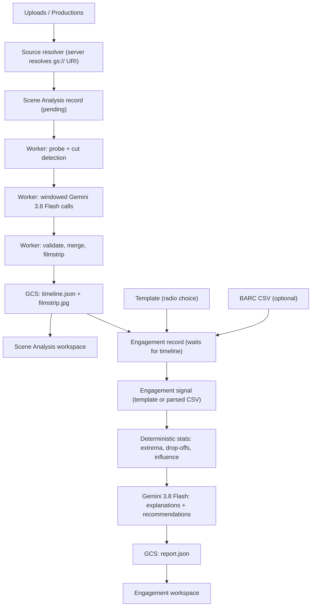

# Scene Analysis & Engagement for Veo Generators — Implementation Plan

**Status: built as described here, with the decisions in section 1. Verified with unit tests, static checkers, browser tests against fixture data, and one live run on a 17-minute video against real Gemini, Firestore and GCS. Section 10 lists what that run found.**

This plan is based on a read-only study of `../superover/superover` (Scene Analysis and Engagement, backend and frontend) and of this repo's architecture, static checkers and existing Key Moments / Reframe features.

## 1. Decisions (resolved)

| # | Decision | Outcome |
|---|---|---|
| 1 | Engagement signal | **Built-in templates** chosen by radio button (`high`, `low`, `jumpy`, `slow_burn`, `front_loaded`), with an **optional BARC CSV upload**. There is no AI-predicted curve. Template curves are illustrative and are labelled "Template (simulated)" in the UI. |
| 2 | Scene data for Engagement | **Integrated.** Engagement reuses the existing Scene Analysis of a video and never analyses it again; one timeline schema serves both features. If a video has no analysis yet, creating an Engagement job creates one. |
| 3 | Charting | **shadcn charts**: `recharts` plus a shadcn-style `components/ui/chart.tsx`. |
| 4 | Uploading new videos | **Link to the Files page.** |
| 5 | Frontend unit tests | **`vitest`** for the timeline maths. |
| 6 | Data scoping | **Same as existing features** (`invite_code` stored as provenance only). |

## 2. What gets built

Two new top-level features, each with a landing page, a create flow and a full-width interactive workspace:

- **Scene Analysis** — Gemini 3.8 Flash turns a video into a structured, timestamped timeline: segments, dialogue and sound cues, characters/objects/locations with on-screen ranges, events, emotions, key moments and narrative beats. The workspace lets you explore that timeline against the video.
- **Engagement** — an engagement curve (a chosen template, or an uploaded BARC file) laid over the same timeline, with detected peaks, valleys and drop-offs, explanations grounded in what is on screen, driver rankings and recommendations.

Both accept **existing uploads**, **completed productions**, or a link out to upload a new video.

## 3. What is taken from superover, and what changes

**Kept:** the absolute-seconds timeline schema; deterministic statistics with LLM prose grounded in them; binding LLM output to server-computed items; the shared-playhead idea (video, chart and panels follow one clock).

**Changed, with the superover problem each change addresses:**

| Superover behaviour | Here |
|---|---|
| Scene results shown as raw JSON; no player or timeline on the Scene pages | A real workspace: synced player, zoomable multi-lane timeline, searchable transcript, entity browser |
| "Peaks" are the global top-N values with a spacing filter; one point can be both a peak and a valley | Local extrema by prominence on a smoothed series |
| Entity influence tests only each sample's start instant, so an entity on screen 00:10–00:50 of a minute gets no samples | Interval-overlap weighting |
| First CSV row assumed to be video t=0; `Duration (Mins)` column plotted as a metric; midnight crossings mis-sorted | Column-mapping preview step, explicit offset, date-aware parsing |
| Explainer prompt receives the whole analysis JSON once per extremum (up to 6 copies) | A ±N-second context slice per extremum |
| Explanations joined to extrema by an LLM-echoed `rank` | Joined by server-issued ids; unknown ids dropped, evidence numbers filled in by the server |
| Chunking by Transcoder jobs; `MAX_TOKENS` continuation by concatenating JSON text | Windowed analysis of the same GCS object; a truncated window is split and retried |
| Results inline in Firestore (1 MiB document limit); chunk order not guaranteed | Results in GCS, indexed by window; Firestore holds the summary |
| Client-supplied GCS paths trusted for read and delete | Client sends a source id; the server resolves the URI |
| Playhead is a chart element, so the chart re-renders twice a second | Playhead is a separate overlay moved outside React rendering |
| Linear scans on every playhead tick; influence recomputed in the browser | Sorted interval index with binary search; statistics computed once on the server |

**Not ported:** Pub/Sub, Transcoder chunking, Chirp pre-transcription, BigQuery/Bigtable, the prompt-management UI, per-artifact endpoints.

## 4. Architecture



### 4.1 Execution model

Both features run on the existing unified worker ([unified_worker.py](../workers/unified_worker.py), [base_processor.py](../workers/base_processor.py)), following the Reframe pattern: the API writes a `pending` record, a `JobProcessor` subclass processes it, and the frontend polls with `usePolling`. This gives progress, retry and no request timeout on long videos. Key Moments' synchronous in-request call was rejected for that reason.

- The scene-analysis processor is registered **before** the engagement processor, so a dependency created by an Engagement job is picked up first.
- The engagement processor's `get_pending_records` returns only jobs whose scene analysis is completed, and fails jobs whose dependency failed. This matters because the worker takes the first pending record per processor; a not-yet-ready job at the head would otherwise block the others.
- Both processors share one staged base class with per-stage checkpoints, so a retry resumes rather than re-paying for completed Gemini calls.

### 4.2 Scene Analysis pipeline

1. **Resolve source.** The client sends `{source_type: "upload" | "production", source_id}`. The server looks up the record and takes the URI from it.
2. **Probe.** Download once to a temp file; duration via `ffprobe_duration`; hard cuts via the existing `detect_cuts` (PySceneDetect).
3. **Plan windows.** Videos up to one window length (5 minutes) are a single call, which covers typical productions. Longer videos are split into non-overlapping windows whose boundaries snap to the nearest detected cut.
4. **Analyse.** One Gemini call per window using `Part.from_uri` on the original object with `VideoMetadata(start_offset, end_offset, fps)`. Calls run with bounded concurrency (proposed 4). Each window result is checkpointed to GCS.
5. **Validate and merge.** Clamp every timestamp to its window, drop inverted ranges, sort, de-duplicate, and merge entities across windows by normalised name and kind. The result is order-independent.
6. **Filmstrip.** One ffmpeg call produces a single sprite image for the timeline's thumbnail lane.
7. **Persist.** `timeline.json` and the sprite go to GCS; the Firestore record keeps summary, counts, duration, usage and paths.

**Timeline schema** (`api/schemas/video-timeline-schema.json`; all times are float seconds from the start of the video):

| Collection | Fields |
|---|---|
| `segments[]` | `start_sec`, `end_sec`, `title`, `synopsis`, `location` |
| `cues[]` | `start_sec`, `end_sec`, `speaker`, `text`, `kind` (dialogue, narration, music, sfx, silence), `sentiment` |
| `entities[]` | `name`, `kind` (character, object, location), `description`, `appearances[]` |
| `events[]` | `start_sec`, `end_sec`, `tag`, `description`, `intensity` |
| `emotions[]` | `start_sec`, `end_sec`, `emotion`, `intensity` (kept per span, not averaged) |
| `key_moments[]` | `start_sec`, `type`, `label` |
| `narrative_beats[]` | `start_sec`, `end_sec`, `beat`, `label` |
| top level | `summary`, `content_title` |

### 4.3 Engagement pipeline

1. **Dependency.** Reuse the Scene Analysis of the same source; create one only if none exists (decision 2).
2. **Signal.**
   - *Template:* one of five built-in profiles, generated deterministically for the video's duration and seeded by the record id, as a 0–100 "Engagement index".
   - *BARC CSV:* the uploaded file is parsed with the mapping confirmed in the preview step (time column, primary metric, offset). Supported directly: BARC minute-level exports with clock times, and generic `time,value` files.
3. **Deterministic statistics** (pure functions, no I/O):
   - smoothing, then peaks and valleys by prominence with a minimum spacing;
   - largest drop-offs (steepest declines);
   - influence per entity, emotion, event tag and location: overlap-weighted mean engagement while present versus overall, with coverage seconds and a low-support flag. Computed with prefix sums and binary search rather than nested scans;
   - per-segment averages and the lowest and highest segments.
4. **Narrative (Gemini 3.8 Flash, text only).** One call explains each peak, valley and drop-off from a context slice around it. One call produces recommendations (do more, do less, per-segment fixes). The model references server-issued ids; the server attaches the numbers.
5. **Persist.** One `report.json` in GCS; summary and usage on the Firestore record.

> [!IMPORTANT]
> Template curves are simulated shapes, not audience measurements. Everything derived from one (peaks, drivers, recommendations) describes how that shape lines up with the video, and the UI says so. Influence figures are associations, not causes, for both templates and BARC data.

### 4.4 Data model and storage

- Firestore collections `{prefix}_scene_analyses` and `{prefix}_engagements`, via thin methods on [firestore_service.py](../api/firestore_service.py) like every other feature.
- Records (`SceneAnalysisRecord`, `EngagementRecord`) carry the standard job fields: `status`, `stage`, `progress_pct`, `error_message`, `usage`, `invite_code`, `archived`, `createdAt`, `completedAt`, plus source fields (`source_type`, `source_id`, `video_gcs_uri`, `video_filename`).
- GCS: `scene_analysis/{id}/timeline.json`, `scene_analysis/{id}/filmstrip.jpg`, `scene_analysis/{id}/windows/{n}.json`, `engagement/{id}/report.json`. Deleting a record purges only its own prefix.

### 4.5 API (all under the existing `/api/v1` convention)

| Route | Purpose |
|---|---|
| `GET/PATCH/DELETE /scene-analysis[/{id}]`, `/archive`, `/retry` | Standard CRUD through `register_crud_routes` |
| `GET /scene-analysis/sources/uploads`, `/sources/productions` | Source lists (existing helpers) |
| `POST /scene-analysis` | Create: `{source_type, source_id, focus?, model_id?, region?}` |
| `GET /scene-analysis/{id}/timeline` | Timeline JSON plus signed filmstrip URL |
| Same CRUD and source routes under `/engagement` | |
| `POST /engagement/signal-preview` | `{upload_id}` → detected columns, sample rows, inferred mapping, warnings |
| `GET /engagement/templates` | Built-in template list with preview points |
| `GET /engagement/sources/analyses` | Existing scene analyses to reuse |
| `POST /engagement` | Create: `{scene_analysis_id \| source_type + source_id, signal: {kind: "template" \| "barc", template_id?, upload_id?, time_column?, metric?, offset_sec?}}` |
| `GET /engagement/{id}/report` | Report JSON |

Writes are already restricted to master and power codes by the existing middleware. Error responses will carry generic messages; details go to the logs.

### 4.6 Gemini usage

- Model: **`gemini-3.8-flash`** for every call in both features, through a new env var `VIDEO_INSIGHTS_MODEL` (default `gemini-3.8-flash`). This is already the default for the existing video analysis in [gemini_video_analysis.py](../api/services/gemini_video_analysis.py) and already has a pricing entry.
- The existing per-request model override (`ModelRegionPicker`) stays available, as in Key Moments.
- Structured output through `response_schema` JSON files in `api/schemas/`, low temperature for extraction, the existing `gemini_call_with_retry` wrapper and `compute_usage` for cost.
- An optional free-text "focus" from the user is passed as delimited data, not as instructions.

## 5. UI design

Both workspaces are full width (the `isFullWidthRoute` check in [App.tsx](../frontend/src/App.tsx) is extended) and are built from one shared timeline kit, so they behave identically.

### 5.1 Shared timeline kit (`components/shared/timeline/`, `hooks/timeline/`, `types/timeline/`)

- **Media clock.** One hook owns the `<video>` element and exposes `seek`, `play`, `pause` and a subscription. The current time is not React state at page level; only the small components that display it subscribe.
- **Viewport.** A single visible time range drives one time-to-pixel scale shared by every lane, so lanes always align. Wheel zooms around the cursor, drag pans, and a minimap with a brush shows and sets the visible range. The time domain is the video duration.
- **Lanes (SVG):** time ruler, filmstrip, segments, key moments and beats (glyphs with collision stacking), emotions (opacity by per-span intensity), pinned-entity lanes and cue density. The engagement curve lane is a shadcn (Recharts) chart whose x-axis is bound to the shared visible range.
- **Playhead and scrubbing.** An overlay line that follows the clock; click or drag anywhere on the ruler to scrub.
- **Hover card.** Crosshair with segment title, who is on screen, the current cue, the emotion, and the engagement value where present.
- **Interval index.** Sorted arrays with binary search answer "what is active at time t" for every lane and panel.
- **Synced player.** Keyboard: space, ←/→ 5 s, J/K/L, `[` and `]` for previous and next segment; playback rate; loop the selected segment or range.

### 5.2 Scene Analysis workspace

```text
┌ Name (editable) · source badge · model · status        [Run Engagement] [Export ▾]
├────────────────────────────────┬──────────────────────────────────────────────────
│ Video player                   │ Overview | Transcript | Entities | Moments | Events
│ Now: segment · on-screen chips │   (search box filters the active tab)
│      current cue               │
├────────────────────────────────┴──────────────────────────────────────────────────
│ ruler ───────────────────────────────────────────────────────────────── [zoom − +]
│ filmstrip │ segments │ moments │ emotions │ pinned entities │ cue density
│ minimap with brush
└ Services used
```

Interactions:

- Click any segment, cue, moment, event or entity appearance to seek. Seeking does not pause or scroll the page.
- **Transcript:** full list, search with highlight, filter by speaker or kind, auto-follows the playhead, click a line to seek.
- **Entities:** grouped by kind with screen time and first appearance. Pin several at once to compare them as lanes.
- **Lane toggles** to show or hide tracks.
- **Deep links:** time and selection are kept in the URL, so a link reopens at the same moment.
- **Export:** timeline JSON, CSV per collection, and SRT/VTT subtitles from cues, generated in the browser from loaded data.
- **While processing:** a stage stepper (probing, analysing window k of n, merging, thumbnails) with progress.

### 5.3 Engagement workspace

```text
┌ Name · source badge · signal badge (Template (simulated) / BARC) · status [Export ▾]
├────────────────────────────────┬──────────────────────────────────────────────────
│ Video player                   │ At this moment: value vs average · segment
│                                │ on screen · mood · current cue
├────────────────────────────────┴──────────────────────────────────────────────────
│ Engagement curve: signal line, smoothed, average, peaks ▲ valleys ▼ drops
│ segments │ moments │ emotions │ pinned entities                  [metric toggles]
│ minimap with brush
├───────────────────────────────────────────────────────────────────────────────────
│ Overview | Peaks & Valleys | Drivers | Recommendations | Data
└ Services used
```

Interactions:

- **Curve:** click or drag to scrub at any time, not just at data samples. Toggle metrics and smoothing. Every metric gets a readable axis on hover.
- **Range inspector:** brush a time range to see its average against the overall average, who is on screen, and the cues inside it.
- **Peaks & Valleys:** cards with the explanation and evidence. Clicking one seeks and zooms the timeline to that window.
- **Drivers:** ranked influence for characters, emotions, events, locations and objects, each with coverage and support. Select several to shade their ranges on the curve and compare them.
- **Recommendations:** do more, do less, and per-segment fixes. Every evidence chip seeks to its timestamp.
- **Data:** the parsed signal, the column mapping and the alignment offset.
- **Export:** report JSON and CSV.

*Stretch, can be cut:* adjusting the alignment offset after the fact, with statistics recomputed immediately and the narrative marked as needing regeneration.

### 5.4 Landing and create flows

- **Landing pages** use the existing `LandingPageShell` and `RecordCard`.
- **Scene Analysis create:** pick a video (Uploads or Productions tabs, search, "Upload new video" link to Files), optional focus text, start.
- **Engagement create:** (1) pick an analysed video (or any upload/production, which is analysed first); (2) choose the signal with radio buttons, one per template with a small preview, plus "Upload BARC file", which shows a CSV preview with detected columns, a metric selector and an offset field; (3) start.
- The picker is a shared component generalised from the Key Moments one, built on the existing [VideoSourceSelector.tsx](../frontend/src/components/shared/VideoSourceSelector.tsx) and `useVideoSourceState`.
- Two sidebar entries, "Scene Analysis" and "Engagement", in [Layout.tsx](../frontend/src/components/Layout.tsx).

### 5.5 Performance and accessibility

- Lanes render only items in the visible range. Dense curves are downsampled to roughly one point per pixel. The transcript list is windowed.
- All timeline items are keyboard reachable with visible focus. Marker types differ by shape as well as colour. Animations respect reduced-motion.
- Uses existing theme tokens and `components/ui` primitives; no raw `<button>`, `<a>`, `<input>` or `fetch`.

## 6. File plan

**Backend, new**

| Path | Contents |
|---|---|
| `api/video_insights/` (new package, Tier 2) | `timeline_windows.py`, `timeline_merge.py`, `source_resolver.py`, `insight_prompts.py`, `insight_records.py`, `signal_files.py`, `insights_store.py` (Firestore accessors, mixed into `FirestoreService`) |
| `api/engagement_signals/` (new package, Tier 2, pure) | `engagement_series.py`, `signal_templates.py`, `signal_parser.py`, `csv_cells.py`, `csv_columns.py`, `signal_peaks.py`, `interval_index.py`, `influence_stats.py`, `report_builder.py`, `report_binding.py` |
| `api/services/gemini_insights.py` | `GeminiInsightsMixin`: window analysis and a generic structured text call used for explanations and recommendations |
| `api/models/domains/models_insights.py` | Records and nested models for both features |
| `api/schemas/` | `video-timeline-schema.json`, `engagement-explain-schema.json`, `engagement-recommend-schema.json` |
| `api/routers/media/scene_analysis.py`, `engagement.py` | Routers |
| `workers/insight_jobs/` (new package) | Shared staged base processor, `SceneAnalysisProcessor`, `EngagementProcessor` |
| `api/tests/video_insights/`, `api/tests/routers/` | Tests (section 8) |

**Backend, changed:** `firestore_service.py` (two collections and the store mixin), `gemini_service.py` (add mixin), `routers/__init__.py` and `main.py` (registration), `sitecustomize.py` and `tests/conftest.py` (new package path), `models/__init__.py`, `pricing_config.py` and `pricing_usage.py` (feature registries for the Services Used panel), `unified_worker.py` (register processors), `.env.example`.

**Frontend, new**

| Path | Contents |
|---|---|
| `types/insights.ts` | Types mirroring the Python contract one to one |
| `lib/api/endpoints/sceneAnalysis.ts`, `engagement.ts` | Typed API clients |
| `types/timeline/`, `types/engagement/` | Pure logic: interval index, viewport maths, downsampling, export formatters, report model, range averages (the tier checker requires shared pure logic here rather than under `lib/`) |
| `hooks/timeline/`, `store/timeline/` | Media clock, viewport, workspace state |
| `components/ui/chart/` | shadcn chart primitive on `recharts` |
| `components/shared/timeline/` | Lanes, ruler, playhead, minimap, hover card, transcript panel, entity panel |
| `components/shared/media/VideoSourcePicker.tsx` | Shared video picker (the synced player lives in the timeline kit) |
| `components/pages/sceneAnalysis/`, `components/pages/engagement/` | Landing, create and workspace pages with their feature-specific components |

**Frontend, changed:** `App.tsx` (six routes, full-width check), `Layout.tsx` (nav and titles), `lib/api.ts`, `types/schemas.ts` (Zod create schemas).

**Docs:** `GEMINI.md`, `README.md`, regenerated `CODEBASE_INDEX.*`.

## 7. Constraints from this repo's checkers that shaped the plan

- **Tier and domain rules.** A page folder may not import from another feature's page folder. Everything the two features share therefore lives in `components/shared/`, `hooks/`, `lib/` and `types/`.
- **Clone detector.** Near-identical functions fail the build. The two processors, the two routers' create paths and the two workspaces are built on shared helpers rather than copied.
- **Size limits** (400 statements per file, 30 per function, 15 files per folder, fewer than four files sharing a prefix). This is why there are new packages rather than more files in `api/services/` (13 of 15) and `workers/` (13 of 15), and why the models go in `models/domains/`.
- **`firestore_service.py`** is at 339 of 400 counted lines, so the two features' accessors live in a mixin (`insights_store.py`) instead of growing that file.
- **Naming.** "Scene analysis" already names Reframe internals (`SCENE_ANALYSIS_PROMPT`, `analyze_video_scenes`, `reframe-scenes-schema`). New code uses `timeline` and `insights` names internally; "Scene Analysis" is the user-facing label and URL only.
- **Semantic logging, strict typing, no raw controls, no browser `fetch`** apply to all new code.

## 8. Tests

Pure-logic tests with no mocks, aimed at the places the superover implementation is wrong:

- **Signal parser:** real BARC header layout; duration column not treated as a metric; midnight crossing; explicit offset; malformed rows.
- **Peak detection:** a monotone series yields no false peaks; plateaus; a point is never both peak and valley; spacing respected.
- **Influence statistics:** exact overlap weighting (the 00:10–00:50 case); zero coverage; low-support flag; agreement with a naive reference implementation on random inputs.
- **Timeline merge:** clamping; inverted ranges dropped; cross-window entity merge; same output regardless of window completion order.
- **Window planner:** windows cover the full duration with no gap or overlap; boundaries snap to cuts.
- **Report builder:** unknown or missing ids from the model are dropped or re-requested; numbers always come from server statistics.

With mocks (existing `deps` monkeypatch conventions):

- **Routers:** source resolution rejects unknown ids; guests cannot create; no route shadowing; delete purges only the record's prefix; Engagement creation links or creates its Scene Analysis.
- **Processors:** retry resumes from checkpoints; dependency gating; failures are recorded.

Frontend: `vitest` unit tests for the timeline maths, plus a browser check of each workspace against fixture data.

## 9. Phases and acceptance

| Phase | Work | Done when |
|---|---|---|
| **0. Spike and contract** | Verify windowed video analysis and timestamp fidelity on three samples (a short production, a ~5-minute upload, a 30-minute-plus upload). Freeze the JSON schemas and the Python/TypeScript contract. Produce fixture `timeline.json` and `report.json`. | Schemas and fixtures agreed; the risks in section 10 resolved or a fallback chosen |
| **1. Scene Analysis backend** | Models, store methods, router, Gemini mixin, pure modules, processor, tests | A real upload and a real production each produce a valid `timeline.json`; checkers and pytest pass |
| **2. Timeline kit and Scene Analysis UI** | Shared kit, picker, landing, create, workspace | Every interaction in 5.2 works on fixtures and on real data; `npm run build` and the component checker pass |
| **3. Engagement backend** | Templates, parser, statistics, narrative, router, processor, tests | Template and BARC jobs both produce a valid `report.json` |
| **4. Engagement UI** | Create wizard, workspace | Every interaction in 5.3 works |
| **5. Hardening** | Pricing registries, docs, index regeneration, full `scripts/pre-deploy.sh` | `pre-deploy.sh` passes clean |

After Phase 0 freezes the contract, phases 1 and 2 can run in parallel on separate subagents (the UI builds against the fixtures), and likewise 3 and 4. The contract between agents is the JSON schemas, `types/insights.ts` and the fixtures.

## 10. Live-run findings and known limitations

One live run was made, on a single 17-minute, dialogue-heavy episode (`gemini-3.8-flash`, real Firestore and GCS). Everything below rests on that one video.

**Confirmed**

- Windowed analysis works: `VideoMetadata(start_offset, end_offset)` on a `gs://` part is honoured, and every window returned timestamps measured from the start of the full video. (The code also handles window-relative timestamps, which were not observed.)
- No response was cut short: every window finished with `STOP` and used under 11,000 of the 65,536 output tokens allowed.
- The engagement report was fully populated, and the prose kept to the "simulated curve" wording for a template signal.
- Cost: about $0.20 for the scene analysis and $0.03 for the engagement report.

**Window size matters, and 5 minutes is the default because of this run**

| Window | Dialogue lines | Segments | Scene order against frames |
|---|---|---|---|
| 10 minutes | 88 | 12 | Two adjacent scenes swapped; the title sequence placed about two minutes late |
| 5 minutes | 204 to 209 | 16 to 20 | Correct |
| 3 minutes | 246 | 25 | Correct; one boundary slightly worse than at 5 minutes |

With long windows the model under-describes rather than truncates: it returns a short answer and stops.

**Known limitations**

- **Character names across windows.** Each window names people independently and the merge matches by name, so on a multi-window video the same person appears under several names ("Sanjay Kataria", "Father"), and names varied between runs. This fragments the entity lanes and the Engagement drivers on videos longer than 5 minutes. Single-window videos are not affected. The planned fix is one text-only call after the merge that groups aliases by id, with the server doing the merge.
- **Sliver segments at window boundaries.** A scene cut by a window boundary can leave a segment of a few seconds on one side.
- **Timestamp precision.** Scene order was checked against frames sampled every 18 seconds; boundaries can still be off by tens of seconds. Dialogue timing was not checked against the audio.
- **Worker throughput.** The unified worker is one instance processing one job at a time across all job types. A long Reframe or Dubbing job will delay an analysis.
- **Rate limiting.** The model-call governor exists only inside `productions_service`. These features rely on the existing retry wrapper (retries on 429 only) and on bounded concurrency (4 windows at a time).
- **BARC files.** The parser has not been run on a real BARC export; its format handling is inferred from a sample header.
- **Production sources.** Only productions whose status is `completed` with a final video are offered. Partially assembled productions are not.
