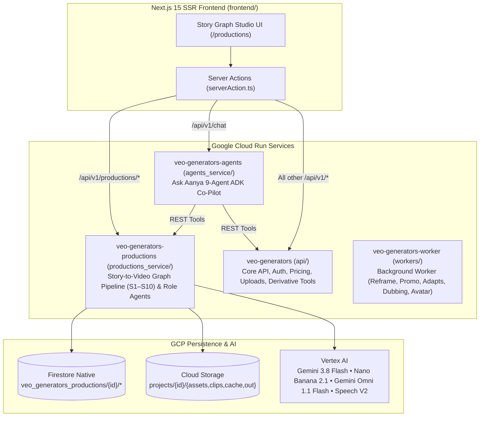
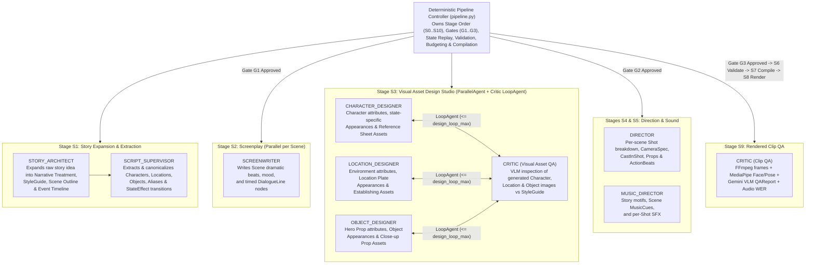

# Story-to-Video Graph Production Service — Implementation Plan

## Goal Description

Move video production into a dedicated Cloud Run microservice (`veo-generators-productions` under `productions_service/`) and replace the legacy production flow with an agentic **Story-to-Video Graph System**.

Starting from a **user's story idea / concept brief** (even a single sentence) or a full story text, the system expands the idea into a persistent **Firestore Story Graph** and orchestrates a studio of specialized **Google ADK Role Agents** alongside deterministic validation, reference budgeting, and prompt compilation:

1. **Story Idea Expansion & World-Building (`S0` / `S1`)**:
   - **`STORY_ARCHITECT` (`story_architect_agent`)**: Takes a raw story idea/concept (`base_concept`, target duration, orientation, language, type) and expands it into a rich multi-scene narrative treatment, global `StyleGuide` (visual look, lens/camera language, lighting, color grading, negative/avoid prompts), and an ordered `Event` timeline.
   - **`SCRIPT_SUPERVISOR` (`script_supervisor_agent`)**: Extracts and canonicalizes every graph `Entity` (`character`, `location`, `object`), aliases, coreferences, and `Event` state effects (`location`, `holding`, `wearing`, `injury`, `alive_present`), followed by deterministic `rebuild_state_facts` and fuzzy identity deduplication (`rapidfuzz`).
2. **Screenplay & Dialogue (`S2`)**:
   - **`SCREENWRITER` (`screenwriter_agent`)**: Enriches each `Scene` with dramatic beat summaries, mood, pacing, and timed `DialogueLine` nodes (speaker `entity_id`, delivery tone, accent/language directives).
3. **Visual Asset Design Studio (`S3` — Dedicated Character, Location & Object Designers)**:
   - **`CHARACTER_DESIGNER` (`character_designer_agent`)**: Defines each character `Entity`'s physical attributes (face, age, build, hair, signature traits with `provenance`) and creates versioned `Appearance` look-sheets for each distinct wardrobe/state implied by `StateFacts` (e.g., `app_char_arjun_default_v1`, `app_char_arjun_injured_v1`). Generates high-resolution character reference sheets via `ImageGenerator` (`gemini-nano-banana-2.1`) and stores them as `Asset` nodes.
   - **`LOCATION_DESIGNER` (`location_designer_agent`)**: Defines each `location` `Entity`'s architectural/environmental attributes, lighting, and atmosphere, creates `Appearance` environment plates, and generates establishing reference `Asset` images.
   - **`OBJECT_DESIGNER` (`object_designer_agent`)**: Defines each key prop/object `Entity`'s material, scale, geometry, and state variations, creates `Appearance` prop sheets, and generates close-up reference `Asset` images.
   - **Visual Critic Loop (`LoopAgent` with `CRITIC`)**: Each generated Character, Location, and Object reference image is inspected by the VLM `CRITIC` (`critic_agent`) against the entity's `Appearance.visual_description` and `StyleGuide`, automatically refining and regenerating up to `design_loop_max` iterations before surfacing to **Gate G2**.
4. **Cinematography & Audio Design (`S4` / `S5`)**:
   - **`DIRECTOR` (`director_agent`)**: Breaks each scene into cinematic `Shot` nodes (`shot_size`, `camera` angle/movement/lens, `CastInShot` with screen positions, `props`, timed `ActionBeat`s `t0-t1s`, and `continue_from_last_frame`). Deterministic code resolves exact `appearance_id` per entity at `shot.story_order` and denormalizes `ref_ids`.
   - **`MUSIC_DIRECTOR` (`music_director_agent`)**: Designs story-wide musical motifs, per-scene `MusicCue` nodes, and per-shot `sfx` cues.
5. **Deterministic Validation, Reference Budgeting & Prompt Compilation (`S6` / `S7`)**:
   - **Validator (`validate.py`)**: Enforces rules `V1`–`V13` (every referenced Character, Location, and Object has an approved `Appearance` and approved image `Asset`, state consistency, duration vs dialogue word-rate, etc.).
   - **Reference Budgeter (`budget.py`)**: Scores candidate visual assets (`100` speaking character, `90` wide location plate, `80` action beat character, `70` close-up prop, etc.), composites character sheets via Pillow when high-priority candidates exceed `caps.max_reference_images`, and injects dropped entities' verbatim `visual_description` into the prompt.
   - **Prompt Compiler (`compile.py`)**: Jinja2 template compiler (`STYLE`, `SETTING`, `CHARACTERS`, `PROP`, `CAMERA`, `CONTINUITY`, `ACTION`, `DIALOGUE`, `AUDIO`, `AVOID`) producing reproducible `Package` objects with SHA-256 `package_hash`.
6. **Rendering, Multimodal Clip QA & Final Assembly (`S8` / `S9` / `S10`)**:
   - Renders shots via `VideoGenerator` (`gemini-omni-1.1-flash-preview` / Veo), evaluates clips via `CRITIC` (`VLM` + MediaPipe face/character consistency + Speech V2 / Gemini audio WER), retries or issues `ChangeRequest`s to `DIRECTOR`, and stitches the final MP4 (`assemble.py`).

---

## Architecture & Service Topology



---

## ADK Studio Agent Hierarchy & Write Scope Matrix



### Role Agents, Responsibilities, Models & Enforced Write Scope (`ROLE_SCOPE`)

Every agent runs via `run_role(role, ctx, ...)` with a fresh `InMemorySessionService` and receives only scoped read tools plus permissioned write tools that enforce `ROLE_SCOPE` and append to `audit_log`:

| Role Enum | Agent Name | Pipeline Stage | Allowed Write NodeTypes (`ROLE_SCOPE`) | Key Tools Provided | Default Model Env |
| :--- | :--- | :--- | :--- | :--- | :--- |
| `STORY_ARCHITECT` | `story_architect_agent` | `S1_EXTRACT` (Idea Expansion) | `StyleGuide`, `Scene` (structure), `Event`, `ChangeRequest` | `put_style_guide`, `put_scene`, `put_event` | `GEMINI_AGENT_CREATIVE_MODEL` (`gemini-3.8-flash`) |
| `SCRIPT_SUPERVISOR` | `script_supervisor_agent` | `S1_EXTRACT` (Entity & State Graph) | `Entity` (`character`, `location`, `object`), `Event`, `Scene` (structure), `ChangeRequest` | `put_entity`, `put_event`, `put_scene`, `propose_entity_merge` | `GEMINI_AGENT_SPECIALIST_MODEL` (`gemini-3.8-flash`) |
| `SCREENWRITER` | `screenwriter_agent` | `S2_SCREENPLAY` | `Scene` (`summary`, `mood`), `DialogueLine`, `ChangeRequest` | `update_scene_script`, `put_dialogue` | `GEMINI_AGENT_CREATIVE_MODEL` (`gemini-3.8-flash`) |
| `CHARACTER_DESIGNER` | `character_designer_agent` | `S3_DESIGN` | `Entity.attributes` (`character` only, `provenance=invented\|inferred`), `Appearance` (`character`), `Asset` (`character_sheet`), `ChangeRequest` | `set_character_attributes`, `add_character_appearance`, `generate_character_asset` | `GEMINI_AGENT_CREATIVE_MODEL` + `STORYBOARD_MODEL` (`gemini-nano-banana-2.1`) |
| `LOCATION_DESIGNER` | `location_designer_agent` | `S3_DESIGN` | `Entity.attributes` (`location` only, `provenance=invented\|inferred`), `Appearance` (`location`), `Asset` (`location_plate`), `ChangeRequest` | `set_location_attributes`, `add_location_appearance`, `generate_location_asset` | `GEMINI_AGENT_CREATIVE_MODEL` + `STORYBOARD_MODEL` (`gemini-nano-banana-2.1`) |
| `OBJECT_DESIGNER` | `object_designer_agent` | `S3_DESIGN` | `Entity.attributes` (`object` only, `provenance=invented\|inferred`), `Appearance` (`object`), `Asset` (`prop_sheet`), `ChangeRequest` | `set_object_attributes`, `add_object_appearance`, `generate_object_asset` | `GEMINI_AGENT_CREATIVE_MODEL` + `STORYBOARD_MODEL` (`gemini-nano-banana-2.1`) |
| `DESIGNER` | `visual_design_lead` | `S3_DESIGN` (Coordinator / Alias) | Union of `CHARACTER_DESIGNER`, `LOCATION_DESIGNER`, `OBJECT_DESIGNER` (`Entity.attributes`, `Appearance`, `Asset`, `ChangeRequest`) | Coordinates `ParallelAgent` fan-out across Character, Location, and Object designers | `GEMINI_AGENT_CREATIVE_MODEL` (`gemini-3.8-flash`) |
| `DIRECTOR` | `director_agent` | `S4_SHOTS` | `Shot` (`cast` intent, `location_id`, `prop_ids`, `camera`, `beats`, `continue_from_last_frame`), `ChangeRequest` | `put_shot`, `create_change_request` | `GEMINI_AGENT_CREATIVE_MODEL` (`gemini-3.8-flash`) |
| `MUSIC_DIRECTOR` | `music_director_agent` | `S5_MUSIC` | `MusicCue`, `Shot.music_cue_id`, `Shot.sfx`, `ChangeRequest` | `put_music_cue`, `set_shot_audio` | `GEMINI_AGENT_SPECIALIST_MODEL` (`gemini-3.8-flash`) |
| `CRITIC` | `critic_agent` | `S3_DESIGN` (Asset QA) & `S9_QA` (Clip QA) | `GenerationRun.qa_scores`, `GenerationRun.status`, `Asset.qa_notes`, `ChangeRequest` | `record_asset_critique`, `record_clip_qa`, `create_change_request` | `GEMINI_AGENT_SPECIALIST_MODEL` (`gemini-3.8-flash` VLM) |

---

## Proposed Changes

### 1. StoryGraph Core Package (`productions_service/storygraph/`)

- **`errors.py`**: Defines `StoryGraphError`, `PermissionDenied`, `ValidationFailed`, `GateBlocked`, `BudgetExceeded`, `PromptTooLong`, `AlreadyExists`, `NotFound`, `DocTooLarge`, `StructuredOutputError`.
- **`config.py` & `config/default.yaml`**: Pydantic `Config` model with role model mapping (`story_architect`, `script_supervisor`, `screenwriter`, `character_designer`, `location_designer`, `object_designer`, `designer`, `director`, `music_director`, `critic_vlm`), image/video provider settings, QA thresholds, and budget caps.
- **`schema.py`**: Complete Pydantic models across all 6 graph layers:
  - **Identity Layer**: `EntityType` (`character`, `location`, `object`), `AttributeVal`, `Entity`, `StateEffect`, `Event`.
  - **State Layer**: `StateFact` (`valid_from_order: int`, `valid_to_order: int | None`, `derived: bool = True`).
  - **Appearance & Asset Layer**: `Appearance` (versioned, `supersedes`, `status`), `Asset` (`character_sheet`, `location_plate`, `prop_sheet`, `composite_sheet`, `first_frame`, `audio`).
  - **Screenplay & Shot Layer**: `StyleGuide`, `Scene`, `DialogueLine`, `MusicCue`, `CastInShot`, `ActionBeat`, `CameraSpec`, `Shot` (`ref_ids`, `stale`, `stale_reason`, `story_order`).
  - **Generation & Governance Layer**: `QAReport`, `GenerationRun`, `ChangeRequest`, `Gate`, `StageRun`, `AuditEntry`.
- **`store/` (`base.py`, `codec.py`, `memory.py`, `firestore.py`, `gcs.py`)**: Implements `GraphStore` and `BlobStore` with `MemoryStore`, `LocalBlobStore`, `FirestoreStore`, and `GcsBlobStore`. Document size guard (`DocTooLarge` above `max_doc_bytes`), auto-chunked `batch()`, and `transaction()`.
- **`repo.py` & `audit.py`**: Typed `Repo` wrapping `GraphStore` with transactional version assignment (`v1`, `v2`...) for `Appearance` and `Asset` nodes, automatic `appearance_for` resolution and `ref_ids` denormalization in `put_shot`, and automatic `stale=True` propagation on any new appearance/asset version.
- **`state.py`, `validate.py`, `views.py`**: `rebuild_state_facts(repo)`, `state_at(repo, entity_id, story_order)`, `appearance_for(repo, entity_id, story_order)`, `validate_all` & `validate_shot` (rules `V1`–`V13`), and scoped read views (`scene_view`, `shot_view`, `outline_view`, `entity_design_view`).
- **`budget.py`, `compile.py`, `config/prompt_template.j2`**:
  - `select_references(view, cfg, caps) -> RefPlan`: scores character, location plate, and prop candidates (`100` speaking character, `90` wide location plate, `80` action character, `70` close-up prop, `60` standard location plate, `50` passive character, `40` background prop), reserves a location slot when `slots >= 3`, builds Pillow side-by-side composite sheets when high-priority candidates exceed slots, and injects dropped entities' `visual_description` into the prompt.
  - `compile_shot(view, plan, cfg, caps) -> Package`: renders `prompt_template.j2` with verbatim descriptions, state snapshots, timed beats, dialogue lines, audio cues, and canonical SHA-256 `package_hash`.
- **`tools/` (`registry.py`, `read_tools.py`, `write_tools.py`)**: Enforces `ROLE_SCOPE` across all 10 roles, including entity-type sub-scoping so `CHARACTER_DESIGNER` can only modify `character` entities/appearances/assets, `LOCATION_DESIGNER` only `location`, and `OBJECT_DESIGNER` only `object`.
- **`agents/` (`runner.py`, `roles.py`, `design_studio.py`, `critic.py`, `prompts/*.md`)**:
  - `run_role()` executing ADK `LlmAgent` with fresh `InMemorySessionService`, scoped tools, and structured Pydantic output validation + repair retries.
  - `design_studio.py`: Runs `S3_DESIGN` by fanning out `CHARACTER_DESIGNER`, `LOCATION_DESIGNER`, and `OBJECT_DESIGNER` across extracted entities (via ADK `ParallelAgent` per entity), each wrapped in a `LoopAgent` (capped at `cfg.design_loop_max`) where the designer generates the `Appearance` + reference image `Asset` via `ImageGenerator` (`gemini-nano-banana-2.1`) and `CRITIC` inspects the generated image via `VLM.review` for visual consistency before marking the asset ready for **Gate G2**.
  - `critic.py`: Runs `S9_QA` on rendered video clips (FFmpeg frame extraction + MediaPipe face/character consistency + Gemini VLM `QAReport` + Speech V2 / Gemini audio WER check).
- **`adapters/` & `pipeline/` & `assemble.py`**: Mock and real Vertex AI adapters (`gemini_image.py`, `gemini_video.py`, `vlm.py`, `tts.py`), `Pipeline` (`S0_INGEST` → `S10_ASSEMBLE`), `Gates`, and `assemble()`.

---

### 2. Dedicated Cloud Run Service (`productions_service/main.py` & `Dockerfile.productions`)

- Dedicated FastAPI service (`veo-generators-productions`) serving `/api/v1/productions/*`:
  - `POST /api/v1/productions`: Creates a project from a story idea/concept (`base_concept`), orientation, target length, language, and style preferences, ingesting it into the StoryGraph.
  - `GET /api/v1/productions` & `GET /api/v1/productions/{id}`: Lists productions or returns the full StoryGraph state (`entities` grouped by `character`/`location`/`object`, `appearances`, `assets` with signed GCS URLs, `events`, `state_facts`, `scenes`, `shots`, `dialogue_lines`, `music_cues`, `style_guide`, `generation_runs`, `gates`, `stage_runs`, `validation_issues`, `change_requests`, `audit_log`).
  - `POST /api/v1/productions/{id}/run`: Runs the pipeline forward until the next unapproved gate (or end-to-end if `auto_approve_gates=True`).
  - `POST /api/v1/productions/{id}/stages/{stage_id}/run`: Runs a single stage (`S1_EXTRACT`..`S10_ASSEMBLE`).
  - `POST /api/v1/productions/{id}/gates/{gate_id}/approve` & `reject`: Approves/rejects **Gate G1** (Identity & Scenes), **Gate G2** (Character, Location & Object Appearances/Assets), or **Gate G3** (Shot List).
  - `POST /api/v1/productions/{id}/appearances/{appearance_id}/approve` & `regenerate`: Approve or re-run the Designer agent for a specific Character, Location, or Object look-sheet.
  - `POST /api/v1/productions/{id}/shots/{shot_id}/compile`: Previews the deterministic `RefPlan` and compiled `Package` prompt for any shot.

---

### 3. Main API, Ask Aanya Agent Tools & Deployment Scripts

- Route `/api/v1/productions` and `/api/v1/productions/*` in `frontend/src/lib/api/serverAction.ts` to `PRODUCTIONS_SERVICE_ORIGIN` (`veo-generators-productions`).
- Update Ask Aanya's `productions_agent` (`api/agents/specialists/director.py`) to propose story-graph productions and trigger pipeline stages / gate approvals.
- Add `productions` deployment target to `scripts/deploy.sh` (`./scripts/deploy.sh [all|api|agents|productions|worker]`) and include `productions_service/` in `scripts/pre-deploy.sh` and `scripts/check_architecture.py`.

---

### 4. Next.js Frontend — Story Graph Studio (`frontend/src/components/ads/`)

- **Story Idea Ingestion (`ProjectForm.tsx`)**: Enter a story idea/concept (with prompt library templates still available as inspiration), aspect ratio, target duration, language, and gate mode (`Interactive Studio Gates` vs `Auto-Approve Gates`).
- **Story Graph Studio (`RefinePromptView.tsx` & `ProductionSummary.tsx`)**:
  - **10-Stage Pipeline Bar (`S1`–`S10`)** + **Active Gate Banner (`G1`, `G2`, `G3`)** with one-click Approve / Reject & Note controls.
  - **World & Entities Tab (`S1` — Gate G1)**: Inspect Characters, Locations, and Objects/Props extracted by `STORY_ARCHITECT` & `SCRIPT_SUPERVISOR`, their aliases, attributes (with `from_text` / `inferred` / `invented` provenance badges), and the `Event` → `StateFact` timeline.
  - **Visual Design Studio Tab (`S3` — Gate G2)**: Dedicated sub-sections for **Character Sheets** (`CHARACTER_DESIGNER`), **Location Plates** (`LOCATION_DESIGNER`), and **Object/Prop Sheets** (`OBJECT_DESIGNER`), showing versioned `Appearance` cards (`v1`, `v2`), generated reference images, VLM Critic QA notes, and per-asset Approve / Regenerate buttons.
  - **Screenplay, Shots & Prompt Compiler Tab (`S2`, `S4`, `S5`, `S7` — Gate G3)**: Per-scene screenplay, `Shot` cards with camera specs, cast intent, action beats (`t0-t1s`), dialogue lines, music cues/SFX, Reference Budgeter slot allocation (`RefPlan`), and verbatim deterministic compiled `Package` prompt preview.
  - **Validator & Audit Tab (`S6`)**: Live `V1`–`V13` validation report, cross-role `ChangeRequest` queue, and role-agent `AuditLog`.
  - **Renders, Clip QA & Final Cut Tab (`S8`, `S9`, `S10`)**: Per-shot rendered clips, Critic `QAReport` breakdown, and final stitched MP4 player.

---

## Verification Plan

1. **StoryGraph Contract & Milestone Suite (`productions_service/tests/`)**:
   - Store contract tests (`MemoryStore` + emulator-gated `FirestoreStore`).
   - Schema/codec round-trip, Repo versioning, append-only immutability, and `ref_ids` staleness propagation.
   - Deterministic `rebuild_state_facts` and Validator rules `V1`–`V13` (pass & fail cases).
   - Permission matrix across all 10 roles (`STORY_ARCHITECT`, `SCRIPT_SUPERVISOR`, `SCREENWRITER`, `CHARACTER_DESIGNER`, `LOCATION_DESIGNER`, `OBJECT_DESIGNER`, `DESIGNER`, `DIRECTOR`, `MUSIC_DIRECTOR`, `CRITIC`), verifying entity-type isolation.
   - Reference budgeter determinism, Pillow composite sheet generation, and Jinja2 compiler snapshots.
   - End-to-end pipeline run from a short story idea through `S1`–`S10` with mock adapters, verifying gate blocking (`GateBlocked`), resume, and budget caps.
2. **Pre-Deploy Verification Gate**:
   ```bash
   ./scripts/pre-deploy.sh
   ```
