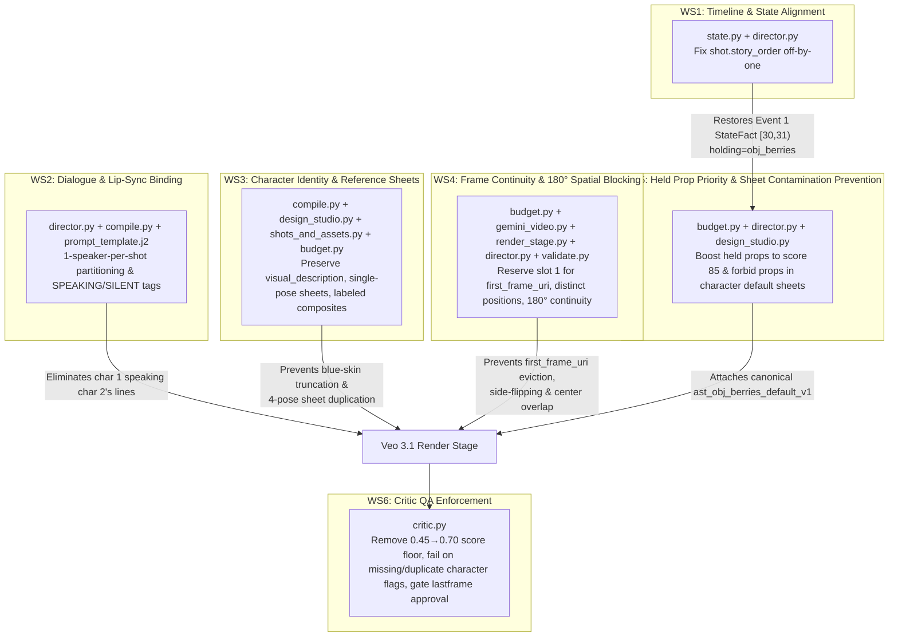

# StoryGraph Remediation Plan — Aranya Kand (`p-whqv0ofw`) Continuity & Identity Fixes

> [!IMPORTANT]
> Companion document to [storygraph-aranya-kand-issues.md](file:///usr/local/google/home/sanjeetsahay/projects/veogen/docs/storygraph-aranya-kand-issues.md). Every workstream below maps directly to one or more of the 6 symptoms observed in Aranya Kand (`p-whqv0ofw`) and adheres strictly to `GEMINI.md` constraints ($\le 400$ statements per file, $\le 25\text{–}30$ statements per function, strict typing, DRY/SOLID, and non-vanity tests).

---

## Architecture & Defect-to-Fix Traceability

| Symptom in Aranya Kand (`p-whqv0ofw`) | Primary Root Causes | Remediation Workstreams |
| :--- | :--- | :--- |
| **1. Speech Inconsistencies** (Char 1 says Char 2's words; missing lines `dlg_scn_001_03`, `dlg_scn_003_05`) | Multi-speaker dialogue crammed into one 8s shot; all cast marked `speaking=True`; `DIALOGUE` block omits screen position & beat timing; `_select_shot_dialogues_and_duration` drops overflow lines | **WS2** |
| **2. Both Characters Look the Same** (Ram & Lakshman identical; clones in frame) | `_render_within_budget` truncates `visual_description` at 120 chars (cutting off `"cotton-candy blue"` at char 121); parallel `EntityDesigner` runs without cross-character contrast; 4-pose turnaround sheets duplicated by I2V; unlabeled side-by-side composites | **WS3** |
| **3. Characters Disappearing** (`char_lakshman` vanishes in `shot_003_01` & `shot_003_02`) | `select_references` fills all 3 `image_uris` slots before `gemini_video.py` appends `first_frame_uri` at index 3 and slices `image_uris[:3]` (100% eviction of `prev_shot_last_frame`); `render_stage.py` drops `prev_shot_last_frame` on Attempt 2; Critic approves clips with `missing_character_lakshman` | **WS4, WS6** |
| **4. Suddenly Appearing on the Other Side** (180° axis flips across shots) | `_resolve_shot_cast` never carries `position` (`left`/`center`/`right`) from Shot $k-1$ to Shot $k$; `first_frame_uri` evicted from Veo request | **WS4** |
| **5. Characters Overlapping** (Shabari & Ram occupy same center space in `shot_003_01`) | `_resolve_shot_cast` allows duplicate `position="center"` for multiple foreground characters; `validate.py` only checks `len(cast) > 2`, not position collisions | **WS4** |
| **6. Fruit Basket (`obj_berries`) Morphs** | `shot.story_order` off-by-one (`31` vs `30`) misses `sf_0035: holding='obj_berries' [30, 31)`; `EntityDesigner` bakes a generic basket into `char_shabari`'s `default` character sheet; `_build_prop_candidates` scores `obj_berries` at `50` so it loses the 3-slot cap | **WS1, WS5** |

---

## Workstream 1: Fix `shot.story_order` Off-by-One (`state.py` & `director.py`)

### Problem
In [`director.py`](file:///usr/local/google/home/sanjeetsahay/projects/veogen/productions_service/storygraph/agents/role/director.py#L340-L349) (`_sync_scene_event_orders`) and [`state.py`](file:///usr/local/google/home/sanjeetsahay/projects/veogen/productions_service/storygraph/state.py#L40-L49) (`normalize_scene_timeline`), `base_order` is computed as `sview.scene.index * 10 + max(0, len(sview.events) - 1)` (`31` for a 2-event scene), and Shot 1 (`idx = 1`) is assigned `story_order = base_order + idx - 1 = 31` (or `32` in `_persist_director_shot` line 297). Meanwhile, Event 1 (`evt_004`) has `story_order = 30` and Event 2 (`evt_005`) has `story_order = 31`. Consequently, any `StateFact` scoped to Event 1 (`[30, 31)`, such as `sf_0035: char_shabari holding='obj_berries'`) is already expired at Shot 1 (`t = 31`).

### Proposed Changes

#### 1. [`productions_service/storygraph/state.py`](file:///usr/local/google/home/sanjeetsahay/projects/veogen/productions_service/storygraph/state.py#L40-L53) (`normalize_scene_timeline`)
- Compute `base_order = scene.index * 10`.
- Assign each event $i \in [0, M-1]$ `evt.story_order = base_order + i`.
- Assign each shot $j \in [0, K-1]$ `shot.story_order = sorted_events[min(j, len(sorted_events) - 1)].story_order` when events exist (or `base_order + j` when a scene has no events), so Shot 1 ($j=0$) evaluates at Event 1's `story_order` (`30`) and Shot 2 ($j=1$) evaluates at Event 2's `story_order` (`31`).

#### 2. [`productions_service/storygraph/agents/role/director.py`](file:///usr/local/google/home/sanjeetsahay/projects/veogen/productions_service/storygraph/agents/role/director.py#L288-L350) (`_persist_director_shot` & `_sync_scene_event_orders`)
- In `_sync_scene_event_orders` (line 340):
  - Set `base_order = sview.scene.index * 10`.
  - Assign `evt.story_order = base_order + i` for $i \in [0, \text{len(events)}-1]$ and return `base_order`.
- In `_persist_director_shot` (line 297):
  - Compute `shot_story_order = base_order + min(idx - 1, max(0, len(sview.events) - 1))` (instead of `base_order + idx`).

---

## Workstream 2: Fix Speech Attribution, Missing Dialogue Lines, and Speaker Binding

### Problem
1. `_select_shot_dialogues_and_duration` in [`director.py`](file:///usr/local/google/home/sanjeetsahay/projects/veogen/productions_service/storygraph/agents/role/director.py#L172-L193) slices `sview.dialogue_lines` across a fixed number of shots (`num_shots = 2`) and drops lines when cumulative word duration exceeds `max_shot_dur` (`8.0s`), losing `dlg_scn_001_03` and `dlg_scn_003_05`.
2. When multiple speakers share a shot (`shot_001_01`, `shot_002_02`, `shot_003_02`), `_resolve_shot_cast` sets `speaking=True` on all of them, and [`prompt_template.j2`](file:///usr/local/google/home/sanjeetsahay/projects/veogen/productions_service/storygraph/config/prompt_template.j2#L3-L19) renders `CHARACTER` lines without `SPEAKING` vs `SILENT LISTENER` markers and `DIALOGUE` lines without screen position (`[left]`, `[right]`) or beat time windows.

### Proposed Changes

#### 1. [`productions_service/storygraph/agents/role/director.py`](file:///usr/local/google/home/sanjeetsahay/projects/veogen/productions_service/storygraph/agents/role/director.py#L112-L226)
- **Dialogue-aware shot count (`_plan_scene_shot_partitions`)**:
  - Group `sview.dialogue_lines` into sequential shot buckets so that:
    1. **Zero dialogue lines are dropped**: Every `DialogueLine` in `sview.dialogue_lines` is assigned to exactly one shot bucket in chronological order.
    2. **Single-speaker preference**: Whenever a scene has enough shot budget (or by dynamically expanding `num_shots` up to `min(max(2, len(sview.events)), 4)` when multiple speakers alternate), split shot buckets at speaker transitions (`dl.speaker_id != prev_speaker_id`) or when estimated speech duration exceeds `7.0s`.
- **Strict `speaking` flag in `_resolve_shot_cast` (line 196)**:
  - Derive `shot_speaker_ids = {dl.speaker_id for dl in shot_dls}` directly from the shot's assigned `shot_dls`.
  - Override `c.speaking = (c.entity_id in shot_speaker_ids)` so non-speaking characters in the shot are guaranteed `speaking = False`.
- **Update `_build_director_prompt` (line 73)**:
  - Instruct the Director LLM that only characters with assigned dialogue in that specific shot may have `speaking=true`, and that each `DialogueLine` must be paired with an `ActionBeat` whose `subjects` includes the speaker.

#### 2. [`productions_service/storygraph/compile.py`](file:///usr/local/google/home/sanjeetsahay/projects/veogen/productions_service/storygraph/compile.py#L65-L126) & [`productions_service/storygraph/config/prompt_template.j2`](file:///usr/local/google/home/sanjeetsahay/projects/veogen/productions_service/storygraph/config/prompt_template.j2#L3-L19)
- In `_build_cast_ctx` (`compile.py` line 65):
  - Include `"speaking": ci.speaking` and `"role_tag": "SPEAKING" if ci.speaking else "SILENT LISTENER — mouth closed, does not speak"` in each cast context dict.
- In `_build_props_and_dialogue_ctx` (`compile.py` line 101):
  - Map each `DialogueLine` to its speaker's `position` (`left`, `center`, `right`) from `view.shot.cast` and compute a sequential time window `(t_start–t_end s)` across the shot duration so each dialogue entry includes `speaker_name`, `speaker_pos`, `recipient_name`, and `time_window`.
- In `prompt_template.j2`:
  - Render cast lines as:
    `CHARACTER {{ c.name }} ({{ c.position }}, {{ c.framing }}, {{ c.role_tag }}): {{ c.visual_description }}...`
  - Render dialogue lines as:
    `- ({{ d.time_window }}) {{ d.speaker_name }} [on {{ d.speaker_pos }}, speaking to {{ d.recipient_name }}]: ({{ d.emotion }}, {{ d.delivery }}) "{{ d.text }}"`
  - Add an explicit lip-sync rule when `dialogue` is non-empty: `"LIP-SYNC RULE: Only the named speaker at the specified screen position moves their lips for each line; all SILENT LISTENER characters keep their mouths closed."`

---

## Workstream 3: Fix "Both Characters Look the Same" (Prompt Truncation, Contrastive Design, Single-Pose Sheets, Labeled Composites)

### Problem
1. [`compile.py`](file:///usr/local/google/home/sanjeetsahay/projects/veogen/productions_service/storygraph/compile.py#L182-L197) (`_render_within_budget`) truncates `c["visual_description"]` to `120` chars on its first pass while leaving `c["wardrobe"]` untouched and wiping `dropped_verbal = []`. For `char_ram`, `"cotton-candy blue"` starts at char 121 and is sliced off in 100% of shots, making Ram's prompt identical to Lakshman's (`fair golden-peach skin` + identical `saffron-ochre tree-bark dhotis`).
2. [`design_studio.py`](file:///usr/local/google/home/sanjeetsahay/projects/veogen/productions_service/storygraph/agents/design_studio.py#L254-L273) runs `EntityDesigner` in parallel (`asyncio.gather`) with zero cross-entity context, producing near-identical `wardrobe_description`s for brothers/co-stars.
3. [`shots_and_assets.py`](file:///usr/local/google/home/sanjeetsahay/projects/veogen/productions_service/storygraph/tools/write_tools/shots_and_assets.py#L84-L102) prompts Imagen for a `"Character turnaround reference sheet... Show front portrait and full-body standing pose"` (4 figures per image), and [`budget.py`](file:///usr/local/google/home/sanjeetsahay/projects/veogen/productions_service/storygraph/budget.py#L44-L66) stitches two 4-pose sheets side-by-side without labels.

### Proposed Changes

#### 1. [`productions_service/storygraph/compile.py`](file:///usr/local/google/home/sanjeetsahay/projects/veogen/productions_service/storygraph/compile.py#L182-L197) (`_render_within_budget`)
- Replace the destructive 2-step truncation with a priority-ordered progressive compaction helper `_compact_ctx_for_budget(ctx, step)`:
  1. **Step 1**: Trim `setting_description` (`[:240]`) and `wardrobe` (`[:180]`), **never** touching `visual_description` or `dropped_verbal`.
  2. **Step 2**: Trim `action_beats` descriptions (`[:120]`) and `wardrobe` (`[:120]`), keeping `visual_description` up to `280` chars and preserving `dropped_verbal`.
  3. **Step 3** (last resort): Trim `visual_description` to `220` chars (never `120`) and compact `dropped_verbal` descriptions to `160` chars rather than wiping `dropped_verbal = []`.

#### 2. [`productions_service/storygraph/agents/design_studio.py`](file:///usr/local/google/home/sanjeetsahay/projects/veogen/productions_service/storygraph/agents/design_studio.py#L177-L290) (`_invoke_entity_designer`)
- Pass a concise `cast_contrast_roster` (listing all characters and props in the production with their canonical names and descriptions) into `_invoke_entity_designer`.
- Add two hard rules to the `EntityDesigner` prompt:
  1. **Visual Distinctiveness Rule**: Every character MUST have a silhouette, primary garment color/drape, and head/hair feature that contrasts clearly with all other characters in `cast_contrast_roster` (e.g., if two characters wear ascetic attire, differentiate their garment hues, sashes, hair/crown silhouettes, and skin tones explicitly in the first 100 characters of `visual_description`).
  2. **Front-Loaded Identity**: Put the character's skin tone, age, face/hair silhouette, and signature color in the **first sentence** ($\le 100$ characters) of `visual_description`.

#### 3. [`productions_service/storygraph/tools/write_tools/shots_and_assets.py`](file:///usr/local/google/home/sanjeetsahay/projects/veogen/productions_service/storygraph/tools/write_tools/shots_and_assets.py#L84-L102) (`_build_asset_generation_prompt`)
- Change the character reference prompt from a multi-pose turnaround sheet (`"Show front portrait and full-body standing pose"`) to a **single full-body front-facing figure**:
  - `"Single full-body front-facing character reference portrait of {entity_name}: {visual_description}. Wearing: {wardrobe}. EXACTLY ONE single standing figure centered on a plain neutral studio background, head-to-toe visible, no split panels, no multiple poses, no inset portraits, no text, no held scene props."`

#### 4. [`productions_service/storygraph/budget.py`](file:///usr/local/google/home/sanjeetsahay/projects/veogen/productions_service/storygraph/budget.py#L44-L95) (`_render_side_by_side_png` & `build_composite_sheet`)
- Order the two entities in `build_composite_sheet` by their horizontal screen position in the shot (`left` $\rightarrow$ `center` $\rightarrow$ `right`) rather than lexical `entity_id` sort, so the left half of the composite matches the character on the left of the shot.
- In `_render_side_by_side_png`, draw a high-contrast top header bar (`36px` height) via `PIL.ImageDraw` labeling `"LEFT PANEL: <Name A>"` over the left half and `"RIGHT PANEL: <Name B>"` over the right half, plus a `4px` vertical divider line between panels.

#### 5. [`productions_service/storygraph/adapters/gemini_video.py`](file:///usr/local/google/home/sanjeetsahay/projects/veogen/productions_service/storygraph/adapters/gemini_video.py#L95-L109) & [`productions_service/storygraph/compile.py`](file:///usr/local/google/home/sanjeetsahay/projects/veogen/productions_service/storygraph/compile.py)
- Include a `REFERENCE IMAGE MAP` section in the compiled prompt (or `compile_shot`) that explicitly maps each attached reference image index (`Reference Image 1`, `Reference Image 2`, `Reference Image 3`) to its role (`Continuity First Frame from previous shot`, `Character Sheet: Shabari`, `Composite Character Sheet: LEFT=Ram, RIGHT=Lakshman`, `Location Plate: ...`).

---

## Workstream 4: Fix Disappearing Characters, 180° Side-Flipping, and Center Overlap

### Problem
1. **100% `first_frame_uri` Eviction**: In [`budget.py`](file:///usr/local/google/home/sanjeetsahay/projects/veogen/productions_service/storygraph/budget.py#L235-L278) (`select_references`), `first_frame` is stored on `SelectionPlan.first_frame`, while `selected` still fills all `max_slots = 3` slots with reference sheets. Then [`gemini_video.py`](file:///usr/local/google/home/sanjeetsahay/projects/veogen/productions_service/storygraph/adapters/gemini_video.py#L95-L109) (`_build_omni_input_blocks`) appends `ff_uri` at the **end** of `image_uris` (index 3) and slices `image_uris[:max_refs]` (`[:3]`), silently dropping `first_frame_uri` on every shot with 3 reference images!
2. **Attempt 2 Drops Continuity**: [`render_stage.py`](file:///usr/local/google/home/sanjeetsahay/projects/veogen/productions_service/storygraph/pipeline/render_stage.py#L140-L148) sets `effective_view.prev_shot_last_frame = None` unconditionally on Attempt 2.
3. **Position Collisions & Axis Flips**: [`director.py`](file:///usr/local/google/home/sanjeetsahay/projects/veogen/productions_service/storygraph/agents/role/director.py#L196-L226) (`_resolve_shot_cast`) allows multiple foreground characters to share `position="center"` (`shot_003_01`) and does not pass previous-shot screen positions into the next shot's prompt or fallback resolver.

### Proposed Changes

#### 1. [`productions_service/storygraph/budget.py`](file:///usr/local/google/home/sanjeetsahay/projects/veogen/productions_service/storygraph/budget.py#L235-L278) (`select_references`)
- When `first_frame is not None` (because `view.shot.continue_from_last_frame` is True and `view.prev_shot_last_frame` exists), reserve 1 slot in the Omni image budget for the continuity frame:
  `entity_slots = max(1, max_slots - (1 if first_frame else 0))`
- Pass `entity_slots` (e.g., `2` when `first_frame` is present on a 3-slot model) into `_select_and_composite_candidates`, so `len(selected) + (1 if first_frame else 0) <= max_slots`. That also triggers composite pairing for the remaining cast/prop references so no cast member is dropped when `first_frame` takes slot 1.

#### 2. [`productions_service/storygraph/adapters/gemini_video.py`](file:///usr/local/google/home/sanjeetsahay/projects/veogen/productions_service/storygraph/adapters/gemini_video.py#L95-L109) (`_build_omni_input_blocks`)
- Prepend `ff_uri` at **index 0** (`image_uris = [ff_uri] + [u for u in image_uris if u != ff_uri]`) before slicing `image_uris[:max_refs]`, guaranteeing that `first_frame_uri` is never evicted by reference sheets.

#### 3. [`productions_service/storygraph/pipeline/render_stage.py`](file:///usr/local/google/home/sanjeetsahay/projects/veogen/productions_service/storygraph/pipeline/render_stage.py#L140-L153) (`_execute_shot_render_loop`)
- Preserve `prev_shot_last_frame` on retry attempts unless the previous attempt's Critic QA report explicitly contains `"frozen_frame"` or `"corrupted_first_frame"` in `artifact_flags`.

#### 4. [`productions_service/storygraph/agents/role/director.py`](file:///usr/local/google/home/sanjeetsahay/projects/veogen/productions_service/storygraph/agents/role/director.py#L196-L226) (`_resolve_shot_cast` & `_build_director_prompt`)
- Track `prev_shot_positions: dict[str, str]` across shots $1..N$ within `run_director_for_scene`.
- Pass `prev_shot_positions` into `_build_director_prompt` with an explicit **180-Degree Screen Continuity Rule**: characters present in the previous shot MUST retain their horizontal screen position (`left`, `center`, `right`) unless an explicit `ActionBeat` moves them across the frame.
- In `_resolve_shot_cast`:
  - First seed any character's position from `prev_shot_positions[entity_id]` if they appeared in the previous shot and no movement beat repositions them.
  - Deduplicate foreground positions (`framing != "background"`): if two foreground characters are assigned the same `position` (e.g., both `"center"` in `shot_003_01`), deterministically reassign the second character to the nearest unoccupied slot (`["left", "center", "right"]`).

#### 5. [`productions_service/storygraph/validate.py`](file:///usr/local/google/home/sanjeetsahay/projects/veogen/productions_service/storygraph/validate.py#L167-L188) (`validate_shot`)
- Add a spatial collision check in `validate_shot`: flag an error (`code="cast_position_collision"`) whenever two or more non-background cast members in the same shot share the exact same `position` (`left`, `center`, or `right`).

---

## Workstream 5: Fix Prop (`obj_berries`) Priority & Prevent Prop Contamination in Character Sheets

### Problem
1. Because of the `shot.story_order` off-by-one (fixed in WS1), `state_at("char_shabari", 31)` returned `{}` instead of `{"holding": "obj_berries"}` in `shot_003_01`.
2. Even when `obj_berries` is in `shot.prop_ids`, [`budget.py`](file:///usr/local/google/home/sanjeetsahay/projects/veogen/productions_service/storygraph/budget.py#L135-L158) (`_build_prop_candidates`) gives props in `action_subjects` (`75`) or `shot.prop_ids` (`50`) a lower score than secondary cast (`80`) and location (`60` on MCU / `90` on WS), so `ast_obj_berries_default_v1` is dropped from the 3 reference slots.
3. [`design_studio.py`](file:///usr/local/google/home/sanjeetsahay/projects/veogen/productions_service/storygraph/agents/design_studio.py#L177-L215) allowed `EntityDesigner` to write `"hands cupped around a small woven leaf-and-twig basket filled with glossy crimson forest berries"` directly into `char_shabari`'s `default` character appearance, creating two conflicting berry basket designs (`ast_char_shabari_default_v1` vs `ast_obj_berries_default_v1`).

### Proposed Changes

#### 1. [`productions_service/storygraph/agents/design_studio.py`](file:///usr/local/google/home/sanjeetsahay/projects/veogen/productions_service/storygraph/agents/design_studio.py#L177-L215) (`_invoke_entity_designer`)
- Add an explicit **No Held Props in Character Default Sheets Rule** to the `EntityDesigner` prompt for `EntityType.CHARACTER`:
  - `"CRITICAL: Do NOT include narrative scene props (such as baskets, fruits, weapons exchanged in scenes, or offerings) in a character's 'default' appearance visual_description or wardrobe_description. Hands must be empty or in a neutral pose so scene props can be bound dynamically via StateFacts."`

#### 2. [`productions_service/storygraph/agents/role/director.py`](file:///usr/local/google/home/sanjeetsahay/projects/veogen/productions_service/storygraph/agents/role/director.py#L288-L307) (`_persist_director_shot`)
- After computing `shot_story_order`, inspect `state_at(g, c.entity_id, shot_story_order).get("holding")` for every cast member `c` in `cast_list`. If a held `prop_id` exists in the graph and is not already in `prop_ids`, append it automatically to `shot.prop_ids`.

#### 3. [`productions_service/storygraph/budget.py`](file:///usr/local/google/home/sanjeetsahay/projects/veogen/productions_service/storygraph/budget.py#L135-L215) (`_build_prop_candidates` & `_select_and_composite_candidates`)
- In `_build_prop_candidates`:
  - Collect `held_props = {st.get("holding") for st in view.cast_states.values() if st.get("holding")}`.
  - Score any prop in `held_props` or `action_subjects` at `85` (above non-speaking secondary cast `80` and MCU/MS location `60`).
- In `_select_and_composite_candidates`:
  - Allow a high-priority held prop (`score >= 75`) to be composited into a 2-up reference sheet with its holder (or another character/prop candidate) when slots are tight, ensuring `ast_obj_berries_default_v1` is visually included in the reference images sent to Veo rather than dropped to text-only `dropped_verbal`.

---

## Workstream 6: Fix Critic QA Score Clamping & Blind Spots (`critic.py`)

### Problem
1. [`critic.py`](file:///usr/local/google/home/sanjeetsahay/projects/veogen/productions_service/storygraph/agents/critic.py#L127-L137) (`_normalize_qa_report`) clamps any VLM score $\ge 0.45$ up to the passing threshold (`0.70`), making it impossible for mediocre clips (`0.45–0.69`) to fail numeric QA.
2. `_normalize_qa_report` (line 138) only overrides `passed = False` on `{"anatomy_glitch", "text_overlay", "frozen_frame", "extreme_blur"}`, ignoring `missing_character_lakshman`, `cast_dropout`, `character_inconsistency`, `skin_color_inconsistency`, and `continuity_prev_shot = 0.25`.
3. `evaluate_clip_qa` (lines 206–218) registers `ast_lastframe_{shot.id}_v{version}` with `Status.APPROVED` **before** checking if the clip passed QA.

### Proposed Changes

#### 1. [`productions_service/storygraph/agents/critic.py`](file:///usr/local/google/home/sanjeetsahay/projects/veogen/productions_service/storygraph/agents/critic.py#L115-L245)
- **Remove the `0.45 -> 0.70` artificial score floor** in `_normalize_qa_report` (delete lines 127–137).
- **Expand severe failure flags & prefix matching**:
  - Fail QA whenever `artifact_flags` contains any flag matching:
    - Exact set: `{"anatomy_glitch", "text_overlay", "frozen_frame", "extreme_blur", "cast_dropout", "hallucinated_character", "character_inconsistency", "skin_color_inconsistency", "costume_inconsistency", "spatial_axis_flip", "character_overlap"}`
    - Prefix match: `flag.startswith(("missing_character", "duplicate_character", "wrong_speaker", "prop_mismatch"))`
- **Enforce Cast Count & Continuity Threshold in `_collect_qa_failures`**:
  - Add explicit rubric instruction in `_build_critic_prompt` requiring the VLM to verify:
    1. Every cast member in `view.shot.cast` is visible (emit `missing_character_<id>` if absent) and no duplicate clones appear (`duplicate_character_<id>`).
    2. Characters' relative left/center/right order matches `view.shot.cast` (emit `spatial_axis_flip` or `character_overlap` if violated).
  - When `view.shot.continue_from_last_frame` is True and `view.prev_shot_last_frame` is present, fail QA if `continuity_prev_shot < 0.60`.
- **Gate `ast_lastframe_*` approval on `passed`**:
  - Move `upsert_node(g, lf_asset)` / `Status.APPROVED` after `passed = len(failures) == 0`, setting `status = Status.APPROVED if passed else Status.PROPOSED` so rejected clips do not poison downstream shots if a subsequent attempt succeeds.

---

## Verification & Regression Test Plan

All changes will be verified using `./scripts/unit-tests.sh` and `./scripts/pre-deploy.sh` (`check_architecture.py`, `check_components.py`, `check_coding_standards.py`, `ruff`, `pytest`).

### New & Updated Non-Vanity Unit Tests (`productions_service/tests/`)
1. `test_story_order_alignment`:
   - Verify a 2-event, 2-shot scene assigns Event 1 = `30`, Event 2 = `31`, Shot 1 = `30`, Shot 2 = `31`, and that `shot_view(g, "shot_003_01").cast_states["char_shabari"]["holding"] == "obj_berries"`.
2. `test_dialogue_partitioning_and_speaker_binding`:
   - Verify a 3-line alternating dialogue scene (`Shabari -> Ram -> Shabari`) drops zero lines across shots, sets `speaking=False` on silent listeners, and renders `(t_start–t_end s) Speaker [on left, speaking to Recipient]` in `compile_shot`.
3. `test_compile_budget_preserves_identity_and_props`:
   - Verify `_render_within_budget` under tight token budgets never truncates `visual_description` to 120 chars (preserving `"cotton-candy blue"` at char 121+) and never wipes `dropped_verbal` before trimming `setting_description` and `wardrobe`.
4. `test_first_frame_slot_reservation_and_ordering`:
   - Verify `select_references` with `max_slots=3` and `first_frame != None` allocates at most 2 slots to reference sheets (compositing extra cast/props as needed), and `_build_omni_input_blocks` places `first_frame_uri` at `image_uris[0]` so it is never truncated by `image_uris[:3]`.
5. `test_spatial_blocking_deduplication_and_continuity`:
   - Verify `_resolve_shot_cast` prevents two foreground characters from both receiving `position="center"` and carries forward `left`/`right` assignments across consecutive shots in the same scene; verify `validate_shot` emits `cast_position_collision` on duplicate foreground positions.
6. `test_critic_rejects_missing_character_and_low_scores`:
   - Verify `_normalize_qa_report` does not inflate `0.50` scores to `0.70`, fails QA when `missing_character_lakshman` or `continuity_prev_shot=0.25` is reported, and marks `ast_lastframe_*` as `PROPOSED` rather than `APPROVED` when QA fails.
